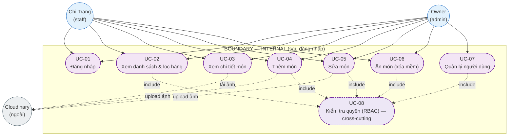
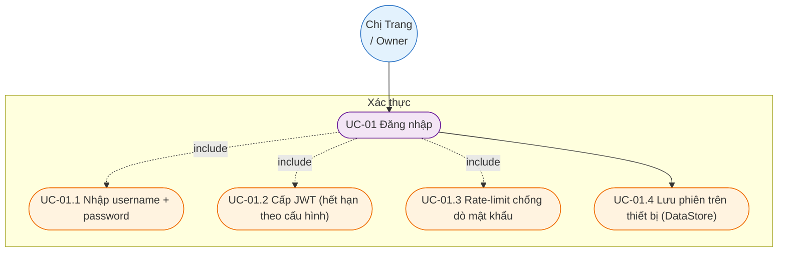
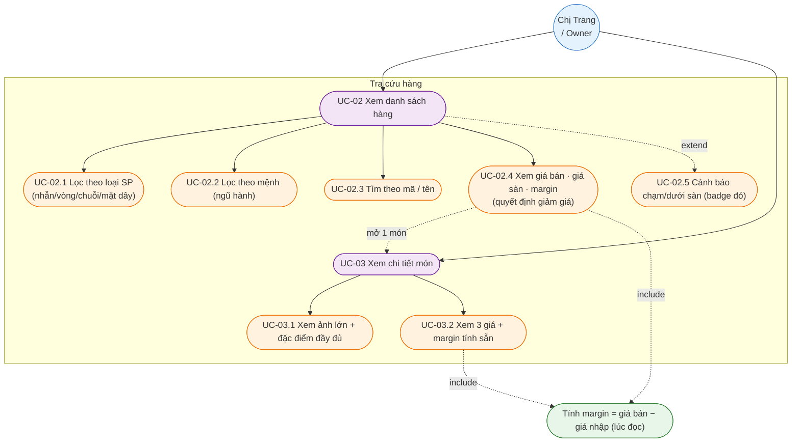
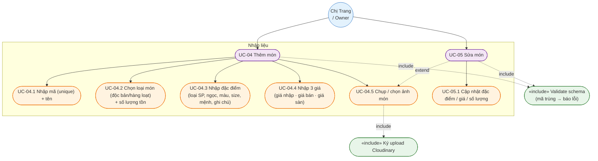
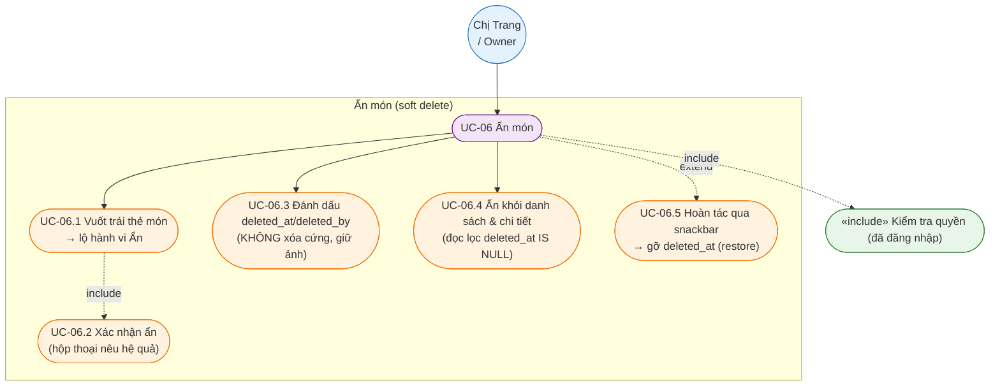
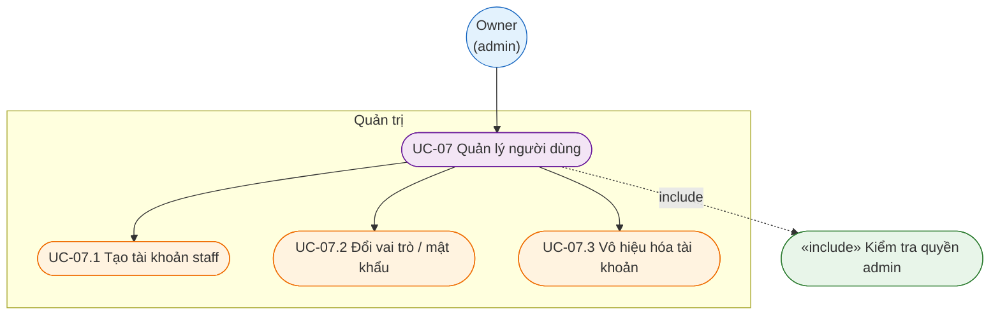

# OmniGem Kho & Giá — Tài liệu Use Case

Trạng thái: **DRAFT** — 2026-10-21 (cập nhật 2026-10-25: UC-06 ẩn món / xóa mềm, mở quyền staff). Nguồn: `inventory-app/prd/PRD.md` (Epic A, B, C).
Mục đích: cái nhìn tổng quan *ai (actor) làm gì (use case)* với app nội bộ, phân rã use case lớn → use case con, kèm quan hệ `«include»` (bắt buộc) / `«extend»` (có điều kiện).

> Ghi chú: Mermaid không có sơ đồ UML use-case riêng — ở đây mô phỏng bằng `flowchart`: actor là hình tròn, use case là hình bo tròn, use case con màu cam.

---

## 1. Phạm vi & triết lý

App nội bộ = **sổ nhập kho + giá** cho 2 người. **Chỉ có một boundary**: toàn bộ hệ thống nằm sau đăng nhập — không có bề mặt công khai. Mọi use case đọc/ghi dữ liệu giá đều **include** bước kiểm tra quyền (RBAC). Dữ liệu giá nhập/giá sàn là nhạy cảm → không bao giờ lộ ra ngoài.

Mục tiêu nghiệp vụ cốt lõi của owner — *"giảm X% còn an toàn không"* — **không** là một use case tính toán riêng, mà đạt được bằng việc **xem danh sách/chi tiết** có hiển thị giá sàn cạnh giá bán + margin (UC-02 / UC-03).

## 2. Boundary (ranh giới hệ thống)

| Boundary | Hệ thống kỹ thuật | Actor tương tác | Đặc tính |
|---|---|---|---|
| **Internal (duy nhất)** | App Kotlin (Android) + Node.js API + PostgreSQL | Chị Trang, Owner | Có xác thực, phân quyền (staff/admin), dữ liệu giá nhạy cảm, no-store |

## 3. Danh sách Actor

### Actor chính (Primary)
| Actor | Vai trò hệ thống | Mô tả |
|---|---|---|
| **Chị Trang** (Staff) | `staff` | NV cửa hàng; nhập/sửa món, chụp ảnh, nhập 3 giá + số lượng tại shop (điện thoại) |
| **Owner** (Leonard) | `admin` | Xem toàn bộ danh sách + margin từ xa để quyết định giảm giá; quản lý tài khoản |

### Actor phụ / hệ thống ngoài (Secondary / External)
**Cloudinary** — lưu & phục vụ ảnh món hàng (client upload trực tiếp bằng signature server ký).

> ⚠️ Giả định đang dùng (PRD §11): owner dùng chính app Android; `staff` xem + sửa tất cả. Nếu đổi, phân quyền UC-02/UC-06/UC-07 sẽ chỉnh theo.

---

## 4. Sơ đồ Use Case TỔNG QUAN

**Đọc sơ đồ:** actor nằm ngoài boundary. UC-08 (RBAC) vẽ nét đứt vì là chức năng cross-cutting, `«include»` vào mọi use case đọc/ghi. Cloudinary là hệ thống ngoài cho ảnh. `staff` và `owner` dùng chung phần lớn use case — **gồm cả UC-06 (ẩn món / xóa mềm)**, vì thao tác an toàn & hoàn tác được; chỉ **UC-07 (quản lý user)** còn giới hạn `admin`. (Xóa cứng vĩnh viễn — nếu làm ở bản sau — mới giới hạn `admin`.)

---

## 5. Phân rã Use Case chi tiết

### UC-01 — Đăng nhập (Epic A)

### UC-02..03 — Xem danh sách & chi tiết (Epic B/C) — màn hình chính của owner

### UC-04..05 — Thêm / Sửa món (Epic B)

### UC-06 — Ẩn món (xóa mềm) — staff + admin

> **Backlog (non-MVP):** màn "Món đã ẩn" cho phép xem lại + khôi phục, và **xóa cứng vĩnh viễn** (chỉ `admin`, kèm dọn ảnh Cloudinary). Chưa thuộc phạm vi bản này.

### UC-07 — Quản lý người dùng (chỉ admin)

---

## 6. Bảng truy vết Use Case → PRD

| UC | Tên | Actor | User story (PRD) |
|---|---|---|---|
| UC-01 | Đăng nhập | staff, admin | US-A1 |
| UC-02 | Xem danh sách & lọc hàng | staff, admin | US-B4, US-C1 |
| UC-03 | Xem chi tiết món | staff, admin | US-B5, US-C1 |
| UC-04 | Thêm món | staff, admin | US-B1 |
| UC-05 | Sửa món | staff, admin | US-B2 |
| UC-06 | Ẩn món (xóa mềm) | staff, admin | US-B3 |
| UC-07 | Quản lý người dùng | admin | US-A2 |
| UC-08 | Kiểm tra quyền (RBAC) — cross-cutting | (hệ thống) | US-A2 |

## 7. Ghi chú thiết kế

- **UC-08 (RBAC)** là cross-cutting: không phải màn hình riêng, mà là guard `«include»` ở mọi endpoint đọc/ghi (middleware ở backend + ẩn/hiện thao tác ở app).
- **Tính margin** luôn ở tầng đọc (lúc hiển thị), không lưu trong DB — nhất quán với PRD §6.
- Phần **mô phỏng giảm giá tự động** là Non-Goal (PRD NG1); owner tự đọc giá sàn vs giá bán.
- **UC-06 là xóa mềm** (`deleted_at`): mọi truy vấn đọc (UC-02/03) `«include»` ngầm điều kiện `deleted_at IS NULL`. Ẩn giữ nguyên ảnh Cloudinary và `product_id`; hoàn tác qua snackbar (UC-06.5). Quyết định Q4 chốt 2026-10-25 — xem `docs/superpowers/specs/2026-10-25-inventory-soft-delete-design.md`.
