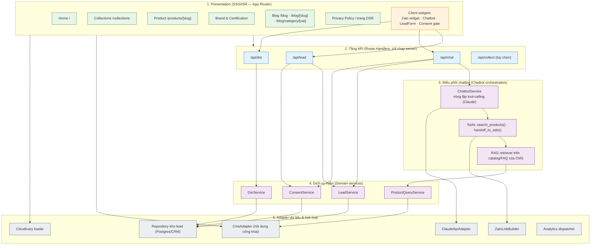

# OmniGem Gallery — HLD (Thiết kế mức cao / High-Level Design)

Trạng thái: **ĐÃ CHỐT (APPROVED)** — chốt ngày 2026-10-15. Tác giả: solution-architect. Người phê duyệt: Architect + Security.
File đồng hành: `system-context.md`, `nfr-targets.md`, `api-spec.yaml`, `erd.md`, `class-diagram.md`, `adr/`.

> **Phạm vi tài liệu:** Đây là bản dịch tiếng Việt **chỉ của PART A — High-Level Design (HLD)** từ `.chapter-forge/artifacts/design/hld-lld.md`. Phần Low-Level Design (LLD/PART B) và các phần phụ (traceability, review-loop) **không** nằm trong file này theo yêu cầu.

> ⚠️ **GHI CHÚ ĐỒNG BỘ (quan trọng — đọc trước):** Bản HLD gốc được viết **trước** khi chốt một số quyết định kiến trúc mới nhất ở PRD. Các điểm dưới đây trong tài liệu còn mang phương án cũ và **cần được đồng bộ (reconcile)**:
> - Chatbot hiện ghi **Claude API / Anthropic** → quyết định mới là **Gemini API (Google)**. Nghĩa vụ xuyên biên giới (Art. 25) vẫn áp dụng, chỉ đổi bên xử lý; mọi yêu cầu DPA (no-training/zero-retention) phải áp cho Google thay vì Anthropic.
> - CMS: quyết định mới là **built-in CMS** (React-Admin + backend riêng), không dùng headless CMS bên thứ ba.
> - Kho lead: quyết định mới là **CRM built-in**, bỏ hoàn toàn Google Sheet.
>
> Bản dịch này giữ nguyên nội dung gốc (bao gồm tên "Claude/Anthropic") để trung thực với tài liệu nguồn; việc đổi tên vendor trong thiết kế/threat-model cần một vòng reconcile riêng vì có hệ quả bảo mật.

---

## PART A — THIẾT KẾ MỨC CAO (HIGH-LEVEL DESIGN)

### A.1 Phân rã thành phần theo tầng (Layered component breakdown)

Năm tầng của hệ thống:
1. **Presentation** — các trang công khai render bằng SSG/ISR (App Router), cộng các client widget (Zalo, chatbot, form lead, cổng đồng ý — consent gate).
2. **Tầng API** — các Route Handler chỉ chạy phía server, xử lý lead/chat/DSR và (tùy chọn) relay analytics.
3. **Điều phối chatbot** — vòng lặp tool-calling, các tool `search_products()`/`handoff_to_zalo()`, và RAG retriever truy xuất catalog/FAQ.
4. **Dịch vụ miền** — logic nghiệp vụ: Lead, Consent, ProductQuery, DSR.
5. **Adapter dữ liệu & tích hợp** — kết nối tới CMS, kho lead, Claude API, Cloudinary, Zalo, analytics.

### A.2 Chiến lược render theo từng loại trang (NFR-3; lý do chi tiết ở ADR-0004)

| Loại trang | Chiến lược | Revalidate | Vì sao |
|---|---|---|---|
| Home `/` | SSG + ISR | 60 phút (+ webhook khi publish) | Nội dung tuyển chọn, ít thay đổi; cần CWV cao nhất |
| Collections `/collections` | SSG + ISR, **lọc phía client** trên tập đã prefetch | 30 phút | Bộ lọc (mệnh/danh mục) là tương tác client tức thì; HTML nền vẫn crawl được |
| Product Detail `/products/[slug]` | SSG + ISR, `generateStaticParams` | 30 phút (+ webhook) | Bề mặt SEO cốt lõi (US-E1 Product JSON-LD); catalog sửa được qua CMS (US-F1) |
| Brand / Certification | SSG + ISR | 60 phút | Trang nội dung |
| Blog listing `/blog` | SSG + ISR, **phân trang**; lọc danh mục/tag phía client trên tập đã prefetch | 30 phút (+ webhook khi publish) | Điểm vào SEO (US-I1); crawl được + trong sitemap |
| Blog archive `/blog/category/[cat]` | SSG + ISR, `generateStaticParams` theo danh mục | 60 phút | Trang archive theo danh mục, index được (US-I3 AC1) |
| Blog detail `/blog/[slug]` | SSG + ISR, `generateStaticParams` | 60 phút (+ webhook khi publish) | Bề mặt SEO (US-I2: Article JSON-LD); có CTA phễu cuối bài (US-I2 AC3) |
| Privacy Policy | SSG (có versioning) | khi publish | **Bản ghi đồng ý tham chiếu tới version của trang này** (US-H2) |
| Trang tiếp nhận DSR | Vỏ SSG + form phía client → `/api/dsr` | — | Vỏ tĩnh, submit động |
| Các route API | Động (server, `runtime=nodejs`) | không bao giờ cache | Xử lý PII; tuyệt đối không được cache tĩnh |

**Quy tắc (CỨNG):** Không response nào chứa PII được cache ở edge/CDN. Các route API đặt `Cache-Control: no-store`.

*Ghi chú blog: các trang blog (`/blog`, `/blog/[slug]`, archive danh mục) không chứa PII nên được cache đầy đủ ở edge/CDN — đây chính là điều giúp blog trở thành kênh traffic SEO chi phí biên gần như bằng không (G4, P4). Chúng đọc nội dung từ CmsAdapter và hình ảnh qua Cloudinary, không chạm tầng dữ liệu PII.*

### A.3 Luồng dữ liệu — 3 luồng nhạy cảm (threat-modeler sẽ dựng sequence diagram STRIDE cho các luồng này)

**Luồng 1 — Gửi form lead (US-C1, US-H2; R-01, R-03)**
1. Khách tải trang Liên hệ (SSG). Cổng đồng ý render **version Privacy Policy hiện hành** + checkbox đồng ý minh thị (mặc định chưa tick).
2. Client xác thực, POST `{name, phone/zalo, dob, productInterest, consent:{version, granted:true}}` tới `/api/lead` qua TLS.
3. Route handler: kiểm tra origin/CSRF → rate-limit → **xác thực schema bằng Zod** → từ chối nếu `consent.granted !== true`.
4. `ConsentService.record()` ghi một **ConsentRecord** (version chính sách, mục đích, timestamp, phương thức, ngữ cảnh request đã hash) — bản ghi tái lập được theo Art. 11, ghi **trong cùng một DB transaction** với Lead.
5. `LeadService.create()` ghi **Lead** (PII, mã hóa khi lưu — encrypted at rest) với `source="lead_form"`.
6. Trả 201 + xác nhận; bắn sự kiện analytics `submit_lead_form` (không có PII trong sự kiện).
7. Khi DB lỗi: 503 có thể retry + hiện CTA fallback Zalo (NFR-4). Không bao giờ commit một phần (không có chuyện có consent mà thiếu lead hoặc ngược lại).

**Luồng 2 — Hội thoại chatbot + handoff (US-D1/D2/D3; R-04, R-09). Đã chỉnh theo phát hiện review C-1, H-1, H-2, H-3.**
1. Khách mở chatbot. Một **bot challenge** (Cloudflare Turnstile / Vercel bot protection) phải vượt qua trước khi phiên bắt đầu (**H-1** denial-of-wallet). Server phát một **`sessionId` ký HMAC** gắn với kết quả challenge; client không thể giả mạo hay xoay vòng nó (**H-1**). Một micro-notice đồng ý được hiển thị **trước bất kỳ lượt nào mang PII**.
2. Mỗi lượt, client chỉ POST **tin nhắn mới của user + `sessionId` đã ký + một khẳng định `consent`** tới `/api/chat` — **không bao giờ gửi các lượt trả lời trước của assistant** (**H-2** chống bypass bằng lịch sử giả mạo). Handler xác minh challenge/chữ ký, áp **giới hạn số tin/token mỗi phiên ở phía server**, và nạp **trạng thái hội thoại do server làm chủ** từ kho riêng của nó (không tin lịch sử do client gửi).
3. **Đồng ý mang tính nguyên tử (atomic — H-3):** ở **lượt đầu tiên mang PII**, server ghi một **`ConsentRecord` theo phạm vi phiên** (method=`chatbot`, ghim version chính sách) **trước khi** lưu bất kỳ transcript nào hoặc dùng DOB — phản chiếu đúng luồng form lead (ADR-0005). Nếu `consent.granted !== true` ⇒ từ chối lượt đó, không xử lý/lưu PII nào.
4. **Bộ lọc đầu vào chạy TRƯỚC cuộc gọi xuyên biên giới (C-1, gộp M-7):** `SensitiveInputScrubber.scrub(userMessage)` phân loại/che (redact) nội dung nhạy cảm Art. 2(4) tình cờ (sức khỏe/tín ngưỡng/tài chính) **và** loại bỏ mọi **chuỗi có dạng số thẻ hợp lệ Luhn** để nó không bao giờ rời Việt Nam và giữ được bất biến "không-dữ-liệu-thẻ". Chỉ văn bản đã scrub mới được chuyển cho `ClaudeApiAdapter`.
5. Server **tái nạp guardrail system prompt mỗi lượt** (không bao giờ hỏi dữ liệu nhạy cảm; tối thiểu hóa dữ liệu; handoff bắt buộc khi có ý định mua; chỉ grounding bằng RAG) — client không thể vô hiệu hóa nó (**H-2**; data-classification mục 9; R-09).
6. `search_products(menh, loai, gia)` → `ProductQueryService` → `CmsAdapter` (catalog trực tiếp, **không có tồn kho bịa** — US-D1 AC2). RAG neo câu trả lời FAQ vào nội dung FAQ trong CMS (US-D2, R-10). **Output của tool-call được xác thực** trước khi trả về cho model (**H-2**).
7. `handoff_to_zalo()` → dựng một Zalo deep-link VÀ gọi `LeadService.create(source="chatbot")` **liên kết tới ConsentRecord của phiên đã được ghi trước đó**. Việc tạo lead do handoff được **rate-limit/dedupe theo phiên** để chống spam lead do injection ép tạo (**H-2**).
8. **⚠️ XUYÊN BIÊN GIỚI (C-1, Art. 25):** chỉ ngữ cảnh lượt tối thiểu **đã scrub** được gửi tới Anthropic. Một **DPA với Anthropic có điều khoản no-training / zero-retention là điều kiện tiên quyết CHẶN go-live** (xem ADR-0003) và được tham chiếu bởi hồ sơ DPIA Art. 24 + hồ sơ Art. 25. Transcript đã scrub được lưu dưới dạng `ChatTranscript` với cờ `sensitive_flagged`.
9. **Cầu dao ngắt chi tiêu toàn cục (H-1):** một trần chi tiêu Claude API hàng tháng cứng (CỨNG, `nfr-targets.md §6`) kích hoạt chatbot rơi về chế độ chỉ-handoff-Zalo. Nếu Claude API lỗi/timeout ⇒ tin nhắn nhẹ nhàng + CTA Zalo (không bao giờ fail cứng; NFR-4, R-06).

**Luồng 3 — Thu thập sự kiện analytics (US-G1; data-classification 11/12)**
1. Ở các tương tác được đo (`view_product`, `click_zalo`, `submit_lead_form`, `chatbot_handoff`), client gửi sự kiện tới GA4 + Meta Pixel.
2. Tag chỉ load **sau khi có đồng ý analytics** (consent gate). Sự kiện **không mang PII trực tiếp** (không tên/số điện thoại/DOB) — chỉ product ID và tên sự kiện.
3. Tăng cường tùy chọn (proxy `/api/collect`): relay first-party phía server để giảm rò rỉ định danh phía client và cho phép thực thi consent-mode ở server.
