# OmniGem Gallery — Solution Design chi tiết: Epic A — Duyệt & Khám phá sản phẩm (UC-01..04)

Trạng thái: **ĐÃ CHỐT (APPROVED)** — 2026-10-15 (PO duyệt). Tác giả: solution-architect. Áp dụng ADR-001 (backend topology) + ADR-002 (kênh handoff & cấu hình động).
Nguồn sự thật: `omni-web/prd/PRD.md` (Epic A, US-A1..A4), `omni-web/usecase/use-cases.md` (UC-01..04), `omni-web/design/hld.md` (A.2 render strategy).
Tài liệu cha: `omni-web/design/solution-design-customer-facing.md` (§6).

> **Quy ước:** Tài liệu này ưu tiên **visualize** — mỗi phần thiết kế đi kèm ít nhất một sơ đồ. Vendor chatbot đã reconcile sang **Gemini**; nội dung đọc qua `ContentRepository` → **public endpoint của `omnigem-api`** (ADR-001), KHÔNG chọc DB trực tiếp.

---

## 0. Mục lục sơ đồ (diagram index)

| # | Sơ đồ | Mục |
|---|---|---|
| D1 | Bản đồ Epic A (cây use case) | §1 |
| D2 | Route map + chiến lược render | §2 |
| D3 | Mô hình dữ liệu Epic A (ERD subset) | §3 |
| D4 | TypeScript domain types (class) | §3.1 |
| D5 | Data fetching ISR + on-publish webhook (sequence) | §4 |
| D6 | UC-01 Home — cây component | §5 |
| D7 | UC-01 Home — sequence render + LCP | §5 |
| D8 | UC-02 Collections — cây component | §6 |
| D9 | UC-02 Collections — state machine bộ lọc | §6 |
| D10 | UC-02 Collections — sequence lọc client | §6 |
| D11 | UC-03 Product Detail — cây component | §7 |
| D12 | UC-03 Product Detail — sequence SSG/ISR | §7 |
| D13 | UC-03 ProductGallery — state máy zoom | §7 |
| D14 | UC-03 — cây quyết định hiển thị giá hybrid | §7 |
| D15 | UC-04 Brand — cây component | §8 |
| D16 | Navigation graph giữa các UC | §9 |
| D17 | "Không ngõ cụt" — cây quyết định phễu | §10 |
| D18 | Bản đồ SEO/JSON-LD | §11 |
| D19 | Ngân sách CWV chú giải trên trang | §12 |
| D20 | Cấu trúc thư mục lát cắt Epic A | §13 |

---

## 1. Bản đồ Epic A (D1)

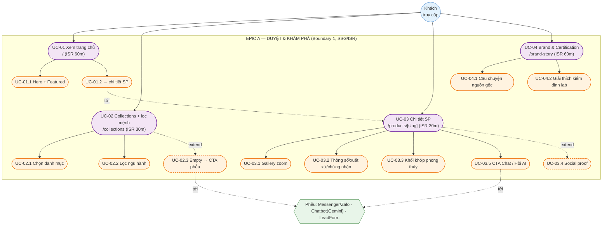

**Đọc:** UC-01..04 đều là trang **public SSG/ISR** (không PII, cache CDN được). Hai nhánh nét đứt (`extend`) là empty-state và social-proof — chỉ xuất hiện có điều kiện. Mọi đường đều đổ về **phễu** hoặc sang Product Detail.

---

## 2. Route map + chiến lược render (D2)

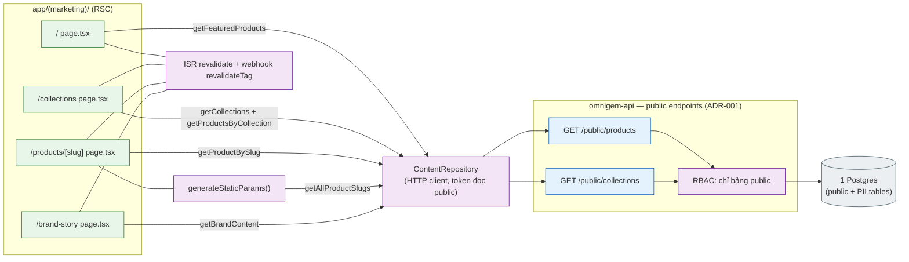

> **Topology (ADR-001):** `page.tsx (RSC) → ContentRepository → omnigem-api /public/* → Postgres`. Next.js **không chọc DB trực tiếp**; endpoint public của `omnigem-api` chạy dưới DB role least-privilege (chỉ `SELECT` bảng public — không bao giờ chạm bảng PII trong cùng DB).

| Route | UC | Strategy | Revalidate | Lý do (HLD A.2) |
|---|---|---|---|---|
| `/` | UC-01 | SSG + ISR | 60m (+webhook) | Nội dung tuyển chọn, cần CWV cao nhất |
| `/collections` | UC-02 | SSG + ISR, **lọc client** | 30m | Lọc tức thì, HTML nền crawl được |
| `/products/[slug]` | UC-03 | SSG + ISR + `generateStaticParams` | 30m (+webhook) | Bề mặt SEO cốt lõi, Product JSON-LD |
| `/brand-story` | UC-04 | SSG + ISR | 60m | Trang nội dung |

**Quy tắc cứng:** không trang nào trong Epic A chứa PII → cache CDN đầy đủ. Đây là nền tảng SEO chi phí biên ~0.

---

## 3. Mô hình dữ liệu Epic A (D3 — ERD subset)

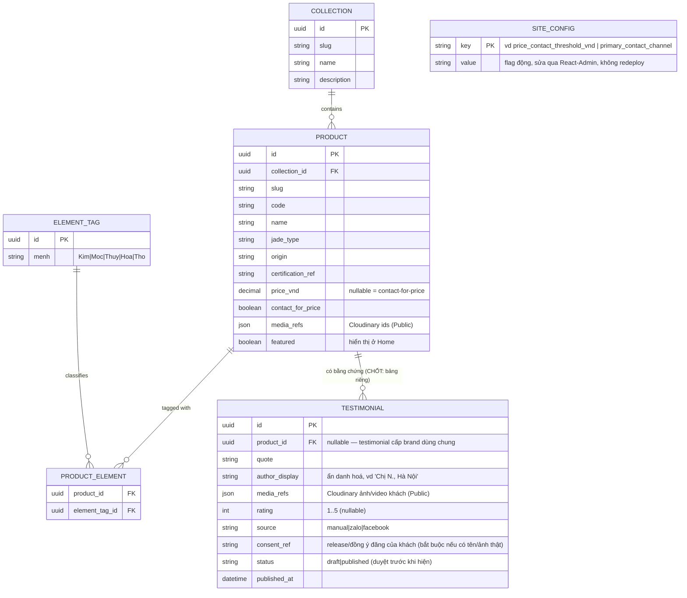

> Thực thể catalog Epic A là **Public**. **CHỐT (điểm 3): `social proof` tách thành bảng `TESTIMONIAL` riêng** — có `status` để duyệt, `source`, `media_refs`, và `consent_ref` (bắt buộc khi testimonial chứa tên/ảnh thật của khách → công bố dữ liệu cá nhân người khác cần release, PDPD). `SITE_CONFIG` giữ các **flag động** (điểm 2 & 4): ngưỡng giá "liên hệ" và kênh handoff chính.

### 3.1 TypeScript domain types (D4)

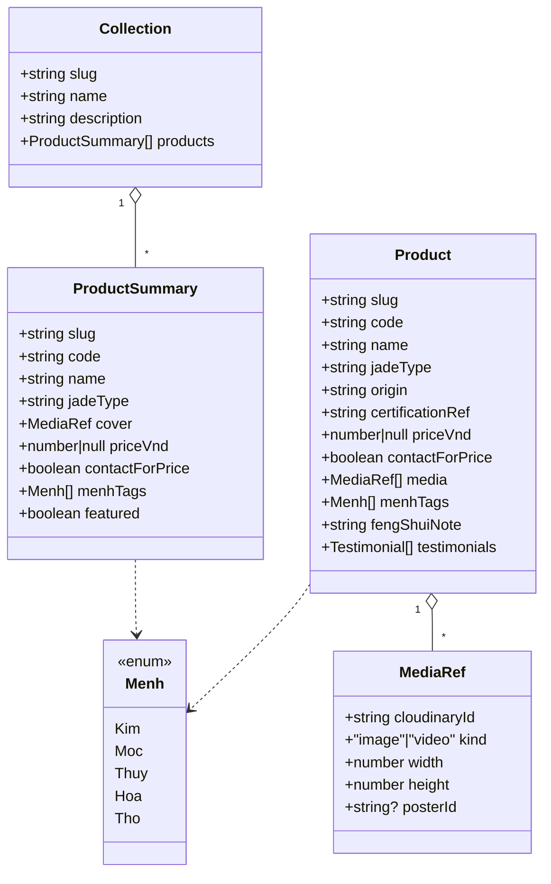

`MediaRef` giữ `width/height` để **reserve dimension** (chống CLS). `priceVnd=null & contactForPrice=true` → render "Liên hệ để được tư vấn".

---

## 4. Data fetching: ISR + on-publish webhook (D5)

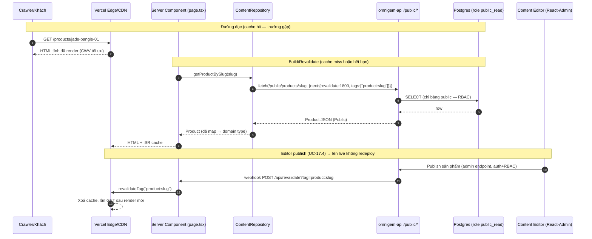

**Điểm chốt:** khách luôn nhận HTML tĩnh (bước 2); gọi `omnigem-api` chỉ xảy ra khi miss/hết hạn/được webhook kích (US-F1 AC1 — publish lên live trong cửa sổ revalidate, không redeploy). Next.js không chọc DB; `omnigem-api` chạm DB dưới role `public_read` nên đường render public **không thể** đọc bảng PII (ADR-001).

---

## 5. UC-01 — Home `/` (US-A1)

### 5.1 Cây component (D6)

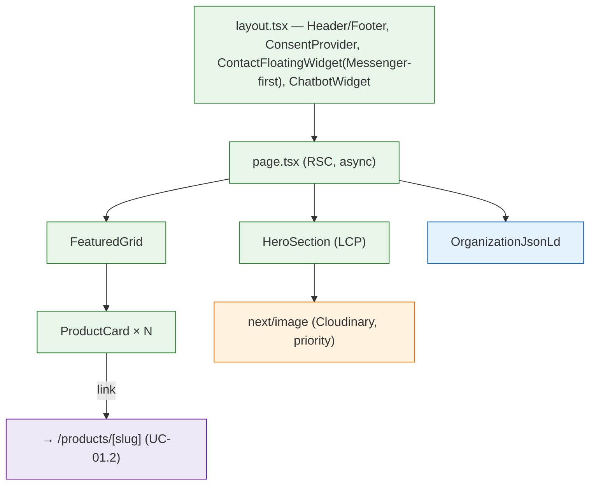

### 5.2 Sequence render + LCP (D7)

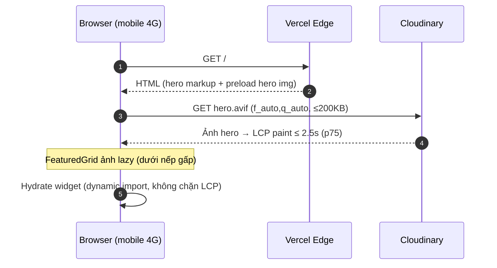

**AC → thiết kế:** AC1 (hero + featured trong budget CWV) → §12; AC2 (mỗi card link tới detail) → `ProductCard` bọc `<Link>`.

---

## 6. UC-02 — Collections + lọc mệnh (US-A2)

### 6.1 Cây component (D8)

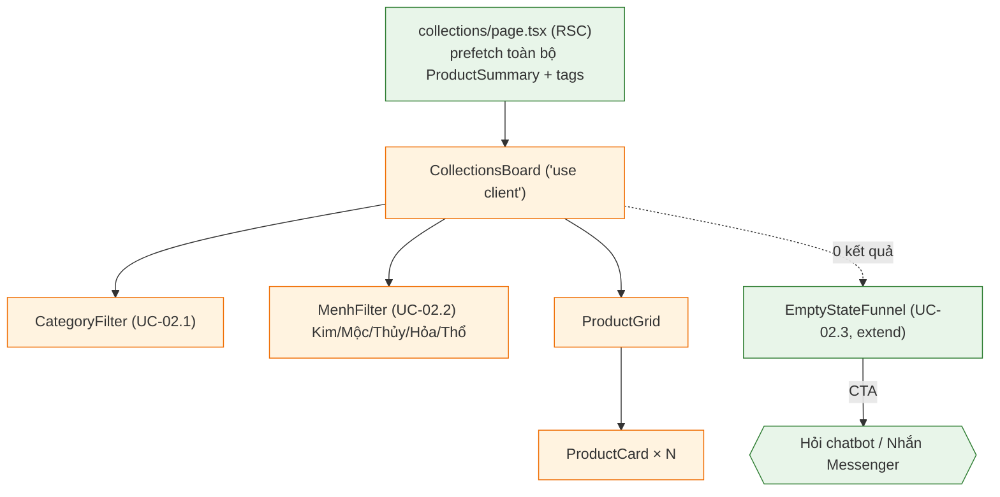

**Quyết định kiến trúc:** server prefetch tập sản phẩm (nhỏ, showroom) → `CollectionsBoard` lọc **phía client** → INP ≤ 200ms, không round-trip, HTML nền vẫn crawl được.

### 6.2 State machine bộ lọc (D9)

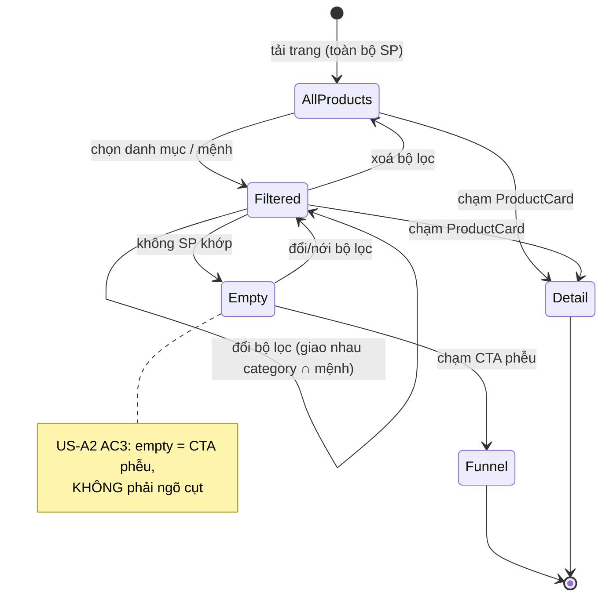

### 6.3 Sequence lọc client (D10)

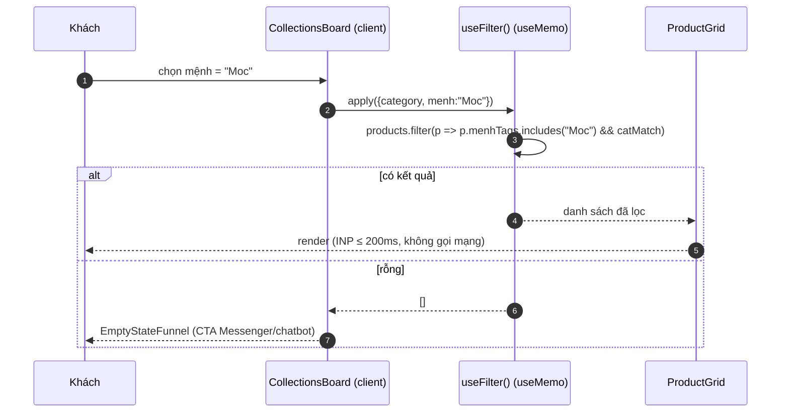

**AC → thiết kế:** AC1 (lọc danh mục) → `CategoryFilter`; AC2 (lọc mệnh) → `MenhFilter` giao với category; AC3 (empty) → `EmptyStateFunnel`.

---

## 7. UC-03 — Product Detail `/products/[slug]` (US-A3)

### 7.1 Cây component (D11)

```mermaid
flowchart TB
    page["products/[slug]/page.tsx (RSC)<br/>getProductBySlug · notFound()"]:::rsc
    gallery["ProductGallery (UC-03.1, zoom)"]:::cli
    spec["SpecPanel (UC-03.2)<br/>jadeType·size·origin·certRef"]:::rsc
    price["PriceOrContact (hybrid)"]:::rsc
    fengshui["FengShuiMatchBlock (UC-03.3)"]:::cli
    proof["SocialProof (UC-03.4, extend)"]:::rsc
    cta["CtaBar above-the-fold (UC-03.5)"]:::cli
    contact["ContactCTA(productCode)<br/>→ ContactChannelResolver"]:::cli
    askai["AskAiButton → ChatbotWidget(ctx=code)"]:::cli
    prodld["ProductJsonLd (US-E1)"]:::seo

    page --> gallery & spec & price & fengshui & cta & prodld
    page -.->|có media chứng thực| proof
    cta --> contact & askai
    contact -->|"Messenger-first: m.me/page?ref=code"| mm["Messenger"]:::ext
    contact -.->|"bật sau qua flag"| zalo["Zalo OA"]:::ext
    contact -->|click_contact {channel, productId}| ga["analytics"]:::seo
    gallery --> img["next/image Cloudinary"]:::cli

    classDef ext fill:#e1f5fe,stroke:#0277bd;

    classDef rsc fill:#e8f5e9,stroke:#2e7d32;
    classDef cli fill:#fff3e0,stroke:#ef6c00;
    classDef seo fill:#e3f2fd,stroke:#1565c0;
```

### 7.2 Sequence SSG/ISR + generateStaticParams (D12)

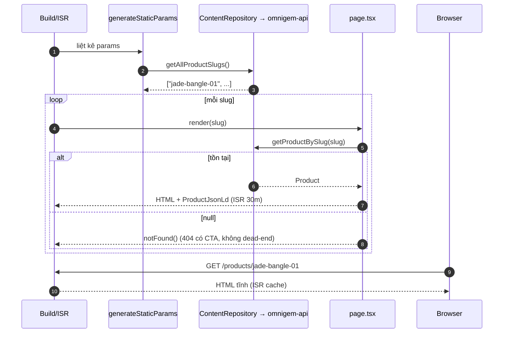

### 7.3 ProductGallery — state máy zoom (D13)

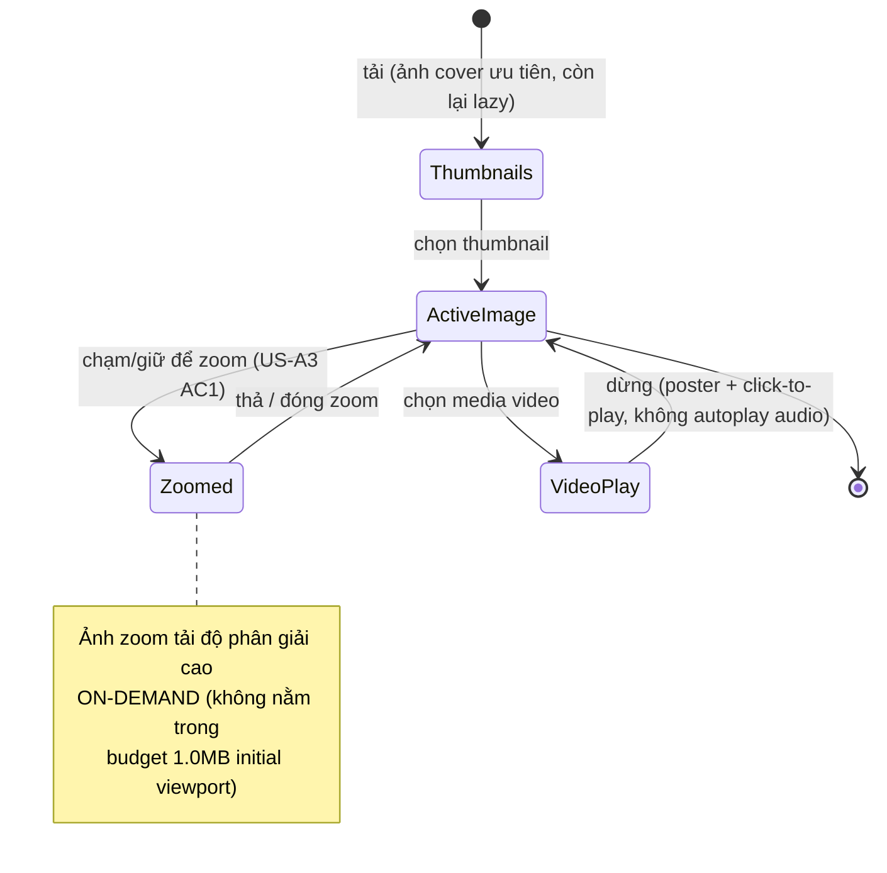

### 7.4 Cây quyết định hiển thị giá (D14 — CHỐT: mặc định hiện giá, threshold động)

Band giá thực tế **500k–5tr** → **mặc định HIỆN GIÁ**; "liên hệ" chỉ là ngoại lệ cho hàng độc bản. Thứ tự ưu tiên: override per-product trước, rồi mới tới threshold động.

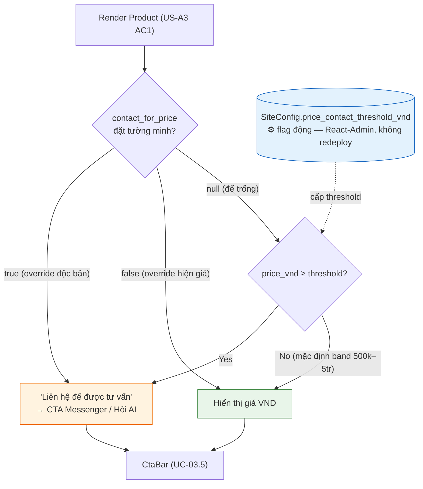

> **CHỐT (điểm 2):** threshold là **flag động** trong `SITE_CONFIG`, không hard-code. Ở band 500k–5tr, hầu hết SP rơi vào nhánh "hiện giá"; `contact_for_price` chỉ override cho hàng hiếm. (PRD §8.6 — không còn chờ một con số cứng từ PO vì giờ là cấu hình động.)

### 7.5 Ghi chú FengShuiMatchBlock (UC-03.3) — ranh giới PII
- Mặc định **chỉ hiển thị** tag ngũ hành của SP + ghi chú khớp mệnh (dữ liệu Public, không PII).
- Tùy chọn progressive-enhancement: ô "nhập năm sinh để xem có hợp" → tính **thuần client** bằng `lib/fengshui/dobToMenh.ts`, **không lưu, không gửi server** → *không* kích hoạt ConsentRecord.
- Muốn tư vấn sâu/cá nhân hóa → điều hướng sang **ChatbotWidget (UC-11)**, nơi DOB được xử lý **có consent** (US-H2). Ranh giới này giữ Product Detail là trang tĩnh, không PII.

**AC → thiết kế:** AC1 (gallery/spec/origin/cert/giá-hoặc-liên-hệ/khối phong thủy) → §7.1+7.4; AC2 (2 CTA above-the-fold mobile) → `CtaBar`; AC3 (social proof có điều kiện) → `SocialProof` «extend».

---

## 8. UC-04 — Brand & Certification `/brand-story` (US-A4, D15)

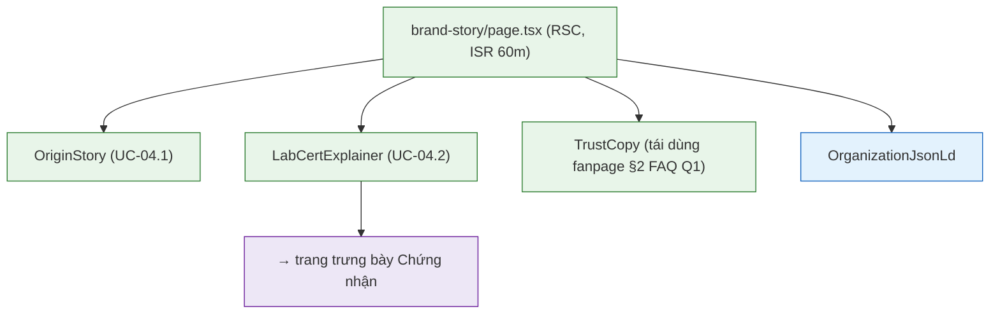

**Nhất quán niềm tin (US-A4 AC1):** `TrustCopy` dùng chung một nguồn với chatbot FAQ (US-D2) và copy fanpage — tránh lệch thông điệp "ngọc tự nhiên 100% + chứng nhận lab".

---

## 9. Navigation graph giữa các UC (D16)

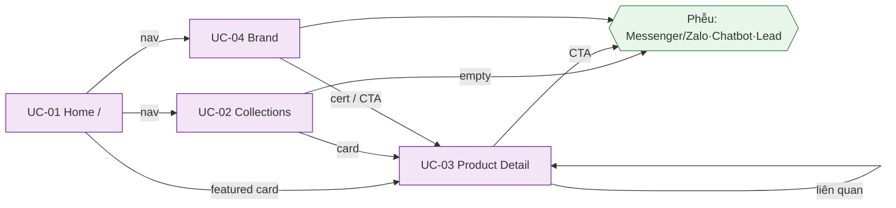

Mọi node đều có ≥1 đường ra tới **phễu** hoặc Product Detail — hiện thực triết lý "không ngõ cụt" ở cấp điều hướng.

---

## 10. "Không ngõ cụt" — cây quyết định phễu (D17)

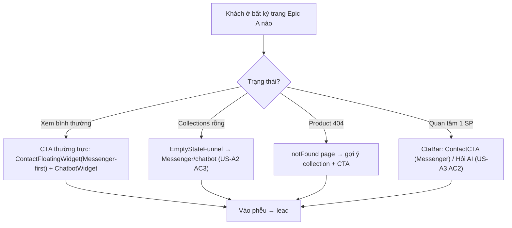

---

## 11. Bản đồ SEO / JSON-LD (D18)

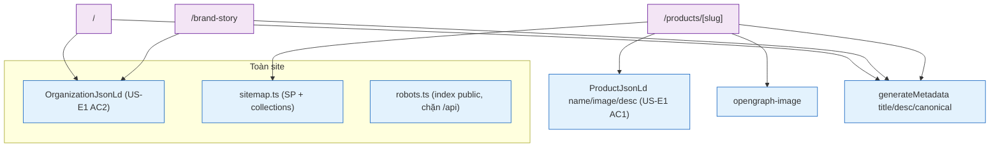

---

## 12. Ngân sách Core Web Vitals chú giải (D19)

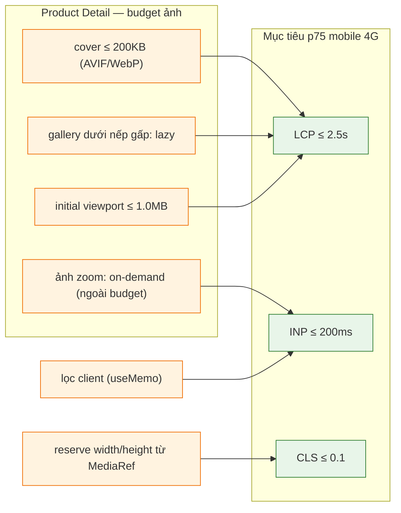

| Kỹ thuật | Chống | Component |
|---|---|---|
| `next/image priority` + preload hero | LCP | HeroSection, ProductGallery cover |
| Cloudinary `f_auto,q_auto` | LCP/bandwidth | mọi ảnh |
| `width/height` từ `MediaRef` | CLS | mọi `next/image` |
| Lọc client `useMemo` | INP (không round-trip) | CollectionsBoard |
| Dynamic import chatbot | TBT/LCP | layout widgets |
| Video poster + click-to-play | CLS/bandwidth | ProductGallery |

---

## 13. Cấu trúc thư mục lát cắt Epic A (D20)

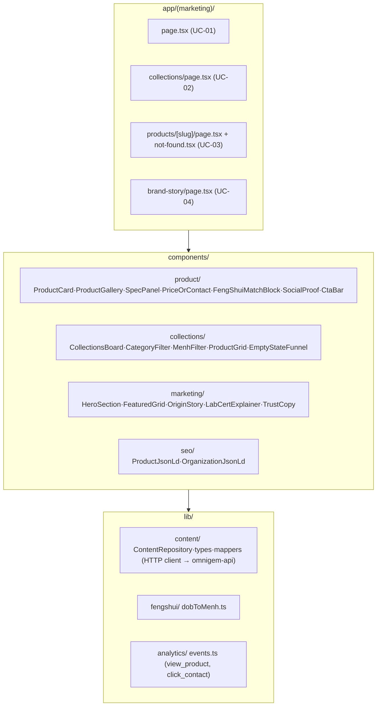

---

## 14. Hợp đồng props các component chính

```ts
// components/product/ProductCard.tsx
interface ProductCardProps {
  product: ProductSummary;         // slug, name, cover(MediaRef), price|contact, menhTags
  // bọc <Link href={`/products/${slug}`}> (UC-01.2 / UC-02 → UC-03)
}

// components/collections/CollectionsBoard.tsx  ("use client")
interface CollectionsBoardProps {
  products: ProductSummary[];      // prefetch từ server (RSC)
  categories: { slug: string; name: string }[];
  // state: { category?: string; menh?: Menh } → useMemo filter → ProductGrid | EmptyStateFunnel
}

// components/product/CtaBar.tsx  ("use client")
interface CtaBarProps {
  productCode: string;             // prefill ref kênh chat + ngữ cảnh chatbot (US-A3 AC2)
  // ContactCTA(productCode) → ContactChannelResolver + AskAiButton(ChatbotWidget, ctx=productCode)
}

// components/product/PriceOrContact.tsx
interface PriceOrContactProps {
  priceVnd: number | null;
  contactForPrice: boolean;        // cây quyết định D14
}
```

---

## 15. Ma trận truy vết AC → thiết kế/sơ đồ

| US / AC | Thiết kế | Sơ đồ |
|---|---|---|
| US-A1 AC1 hero+featured trong CWV | HeroSection priority + budget | D6, D7, D19 |
| US-A1 AC2 card → detail | ProductCard `<Link>` | D6, D16 |
| US-A2 AC1 lọc danh mục | CategoryFilter | D8, D9, D10 |
| US-A2 AC2 lọc mệnh | MenhFilter (giao category) | D8, D9, D10 |
| US-A2 AC3 empty → CTA | EmptyStateFunnel | D8, D9, D17 |
| US-A3 AC1 gallery/spec/giá/phong thủy | ProductGallery·SpecPanel·PriceOrContact·FengShuiMatchBlock | D11, D13, D14 |
| US-A3 AC2 2 CTA above-the-fold | CtaBar (Messenger + Hỏi AI) | D11, D17 |
| US-A3 AC3 social proof có điều kiện | SocialProof «extend» | D11 |
| US-A4 AC1 brand + cert + trust | OriginStory·LabCertExplainer·TrustCopy | D15 |
| US-E1 AC1/AC2 JSON-LD | ProductJsonLd·OrganizationJsonLd | D18 |
| NFR-1/2 CWV mobile | budget ảnh + ISR + lọc client | D19 |

---

## 16. Điểm cần chốt trước khi code Epic A

| # | Điểm | Trạng thái |
|---|---|---|
| 1 | Schema/base URL public endpoint của `omnigem-api` | **CHỐT topology** (ADR-001: gộp 1 backend + RBAC). `ContentRepository` giữ interface ổn định + mock ở P0/P1; schema cụ thể chốt ở Design. |
| 2 | Ngưỡng giá "liên hệ" | **CHỐT:** mặc định hiện giá (band 500k–5tr); `contact_for_price` override; threshold = flag động `SITE_CONFIG` (ADR-002). |
| 3 | Social proof / testimonial | **CHỐT:** bảng `TESTIMONIAL` riêng (`status` duyệt, `source`, `consent_ref`) — xem D3. |
| 4 | Kênh handoff | **CHỐT:** **Messenger-first** (`m.me/page?ref=code`) qua `ContactChannelResolver` + flag; Zalo OA bật sau khi có doanh thu; webhook auto-lead để P3/P4 (ADR-002). |
| 5 | Reconcile PRD §1 | **CHỐT (PO duyệt, bản sửa R1):** PRD §1 + §8.6 đã cập nhật giá 500k–5tr + lý do "giai đoạn đầu bán qua người, online tính sau". Mô hình phễu/NG1 giữ nguyên. |

**Mô hình vận hành đã xác nhận:** thu lead → chăm sóc + chốt qua người (Messenger) → ship / kéo về cửa hàng → *(tương lai)* bán online. NG1 (không checkout) giữ nguyên ở giai đoạn này.
