# OmniGem Gallery — Solution Design chi tiết: Epic B & C — Liên hệ qua phễu (UC-08..10)

Trạng thái: **DRAFT** — 2026-10-15. Tác giả: solution-architect. Áp dụng **ADR-001** (backend topology) + **ADR-002** (kênh handoff Messenger-first & cấu hình động).
Nguồn sự thật: `omni-web/prd/PRD.md` (Epic B — US-B1/B2; Epic C — US-C1; Epic H — US-H2; Epic G — US-G1), `omni-web/usecase/use-cases.md` (UC-08..10, UC-15), `omni-web/design/hld.md` (A.3 Luồng 1).
Tài liệu cha: `omni-web/design/solution-design-customer-facing.md` (§7.2, §7.4, §8, §13). Tài liệu anh/em: `solution-design-epic-a-browse-discover.md` (D11/D14/D17 — ContactCTA, giá động, "không ngõ cụt").

> **Quy ước:** Bám đúng phong cách tài liệu Epic A — **visualize-first**: mỗi phần thiết kế đi kèm ít nhất một sơ đồ. Mọi điểm chạm PII đi qua **TẦNG 2 (BFF Route Handler)** → forward tới PII endpoint của `omnigem-api` (ADR-001); widget client **không bao giờ** chạm DB hay giữ secret.

> **GHI CHÚ ĐỒNG BỘ (bắt buộc đọc):** Theo **ADR-002 (ACCEPTED)**, kênh handoff chính là **Facebook Messenger** (`m.me/<page>?ref=<code>`), KHÔNG phải Zalo. Zalo OA **bật sau** khi có doanh thu bằng cách đổi flag `SiteConfig.primaryContactChannel` — không sửa code. Mọi chỗ PRD/HLD gốc ghi "Zalo"/`click_zalo` hiểu theo nghĩa **"kênh chat handoff (Messenger-first, Zalo OA sau)"** và event đã tổng quát hoá thành **`click_contact { channel, productId }`**. **Webhook auto-tạo lead** từ Messenger/Zalo là **P3/P4** (cần Meta app review `pages_messaging`); ở **P2**, lead chỉ tạo qua **LeadForm (UC-10)** và chatbot handoff (UC-13).

---

## 0. Mục lục sơ đồ (diagram index)

| # | Sơ đồ | Mục |
|---|---|---|
| D1 | Bản đồ Epic B/C (cây use case + phễu) | §1 |
| D2 | Route/endpoint map + topology điểm chạm phễu | §2 |
| D3 | Mô hình dữ liệu phễu (ERD subset — PII tables) | §3 |
| D4 | Domain types + Zod schema dùng chung (class) | §3.1 |
| D5 | `ContactChannelResolver` — cây quyết định kênh + giảm cấp 3 tầng | §4 |
| D6 | UC-08 `ContactCTA` — sequence build deep-link + `click_contact` | §5 |
| D7 | UC-09 `ContactFloatingWidget` — cây component + CSP allowlist | §6 |
| D8 | UC-10 `LeadForm` — cây component | §7 |
| D9 | UC-10 — sequence submit (consent+lead nguyên tử, 503 fallback) | §7 |
| D10 | UC-10 — state machine của form | §7 |
| D11 | UC-15 Consent — hai loại consent & ConsentGate | §8 |
| D12 | Ghi nguyên tử ConsentRecord + Lead (transaction) | §8 |
| D13 | "Không ngõ cụt" — cây quyết định phễu (Epic B/C) | §9 |
| D14 | Analytics phễu (`click_contact`, `submit_lead_form`) | §10 |
| D15 | Cấu trúc thư mục lát cắt Epic B/C | §11 |

---

## 1. Bản đồ Epic B/C (D1)

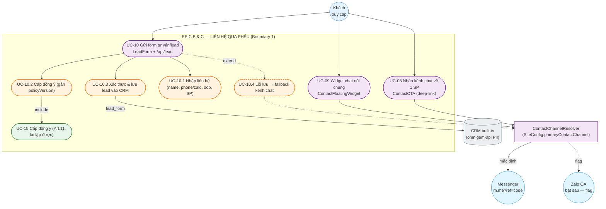

**Đọc:** Epic B (UC-08/09) = **lối ra kênh chat** (không PII phía web — chỉ mở app chat ngoài, mang `ref=code`). Epic C (UC-10) = **thu lead có PII** → bắt buộc «include» UC-15 (consent Art.11) và ghi nguyên tử vào CRM. Cả hai nhánh đều do **`ContactChannelResolver`** quyết kênh (ADR-002), kể cả nhánh fallback UC-10.4.

**Phân biệt bản chất 2 Epic:**

| | Epic B (UC-08, UC-09) | Epic C (UC-10) |
|---|---|---|
| Bản chất | Điều hướng ra kênh chat ngoài | Thu thập PII tại chỗ |
| PII trên web? | **Không** (chỉ `ref=code`) | **Có** (name, phone/zalo, **dob**) |
| Consent? | Không cần (không thu PII) | **Bắt buộc** (UC-15, Art.11) |
| Endpoint | Không (deep-link client) | `POST /api/lead` (BFF → PII) |
| Lead tạo ở đâu? | P2: không (webhook auto-lead là P3/P4) | Ngay khi submit (`source="lead_form"`) |
| Event | `click_contact{channel,productId}` | `submit_lead_form` |

---

## 2. Route/endpoint map + topology điểm chạm phễu (D2)

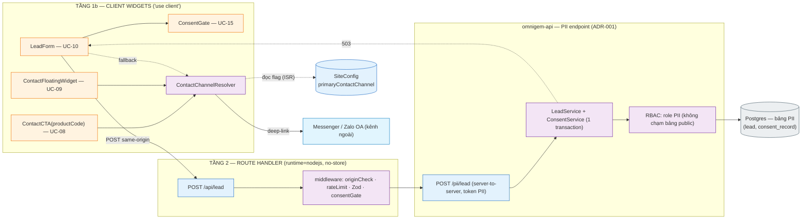

> **Topology (ADR-001):** `LeadForm → /api/lead (BFF) → omnigem-api /pii/lead → Postgres`. Route Handler PII chạy `runtime="nodejs"` + `Cache-Control: no-store`, **không bao giờ** cache edge. `LeadService`/`ConsentService` + DB nằm **trong `omnigem-api`**, không hiện thực ở app Next.js. Nhánh UC-08/09 (Messenger/Zalo) **không đi qua BFF** — chỉ mở deep-link phía client (không PII).

| Route / điểm chạm | UC | Loại | Cache | Lý do |
|---|---|---|---|---|
| `ContactCTA` (client) | UC-08 | Client deep-link | — | Không PII; chỉ build URL `m.me?ref=code` |
| `ContactFloatingWidget` (client) | UC-09 | Client script/plugin | — | Plugin Messenger/Zalo nổi mọi trang |
| `POST /api/lead` | UC-10 | Route Handler (BFF) | **no-store** | Thu PII (name/phone/dob) → forward PII endpoint |
| `SiteConfig.primaryContactChannel` | UC-08/09 | Flag động (ISR) | ISR | Đổi kênh/A-B test không redeploy (ADR-002) |

**Quy tắc cứng:** mọi response của `/api/lead` **không index, không cache**; mọi POST có **origin/CSRF check** (TB-1); **không PII** trong URL/query/log/analytics.

---

## 3. Mô hình dữ liệu phễu (D3 — ERD subset, PII tables)

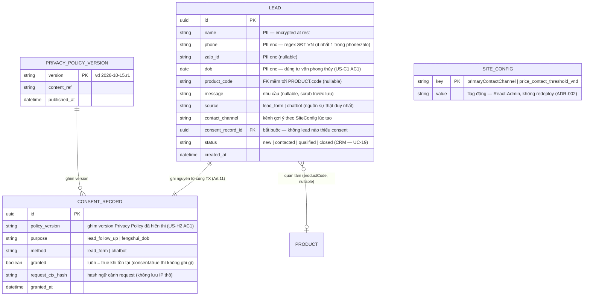

> **Bất biến (HLD Flow 1 bước 4–7):** `LEAD` và `CONSENT_RECORD` **luôn ghi trong cùng một DB transaction** — không bao giờ có lead thiếu consent hoặc ngược lại (no partial commit). `consent_record_id` là **NOT NULL** ở tầng schema để ép bất biến này. Mọi cột PII **encrypted at rest**; bảng này thuộc **role PII** (RBAC), đường render public **không thể** đọc (ADR-001 bất biến 3 lớp). `SITE_CONFIG` tái dùng từ Epic A (D3) — thêm khóa `primaryContactChannel`.

### 3.1 Domain types + Zod schema dùng chung (D4)

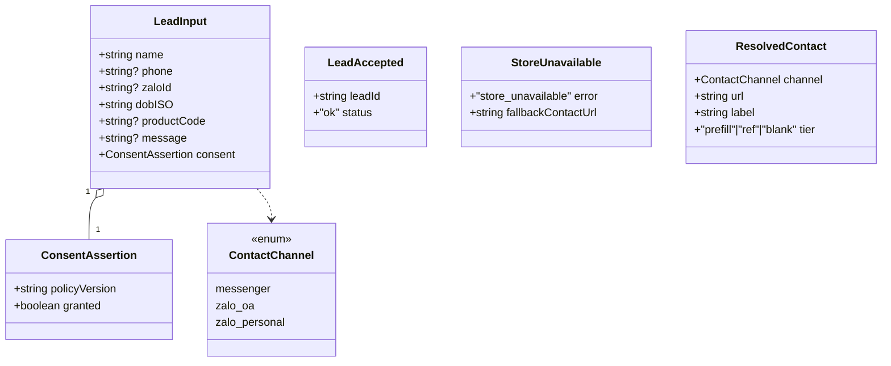

```ts
// lib/schemas/lead.ts — Zod dùng chung CLIENT (validate trước submit) ↔ SERVER (validate khi nhận)
export const LeadInput = z.object({
  name: z.string().min(1).max(120),
  phone: z.string().regex(VN_PHONE).optional(),
  zaloId: z.string().min(3).max(64).optional(),
  dobISO: z.string().date(),                       // DOB → US-C1 AC1 (tư vấn phong thủy)
  productCode: z.string().max(40).optional(),
  message: z.string().max(2000).optional(),
  consent: z.object({
    policyVersion: z.string().min(1),              // ghim version → US-H2 AC1
    granted: z.literal(true),                      // literal(true): consent≠true ⇒ Zod fail, không xử lý PII
  }),
}).refine(v => !!(v.phone || v.zaloId), { message: "Cần ít nhất SĐT hoặc Zalo ID" }); // US-C1 AC1
```

> **1 schema, 2 nơi** (HLD B.1 fail-fast): `consent.granted` là `z.literal(true)` nên request thiếu/sai consent **bị từ chối ngay ở biên** — hiện thực quy tắc "consent≠true thì không ghi gì" (UC-10 ngoại lệ). `.refine()` ép "ít nhất 1 trong phone/zalo" (US-C1 AC1).

---

## 4. `ContactChannelResolver` — cây quyết định kênh + giảm cấp 3 tầng (D5)

Trái tim của ADR-002: kênh handoff **trừu tượng hoá** sau một resolver, do flag động quyết → đổi kênh/A-B test **không redeploy**. Widget (`ContactCTA`, `ContactFloatingWidget`, fallback của `LeadForm`) **không biết** kênh cụ thể — chỉ gọi `resolve(productCode)`.

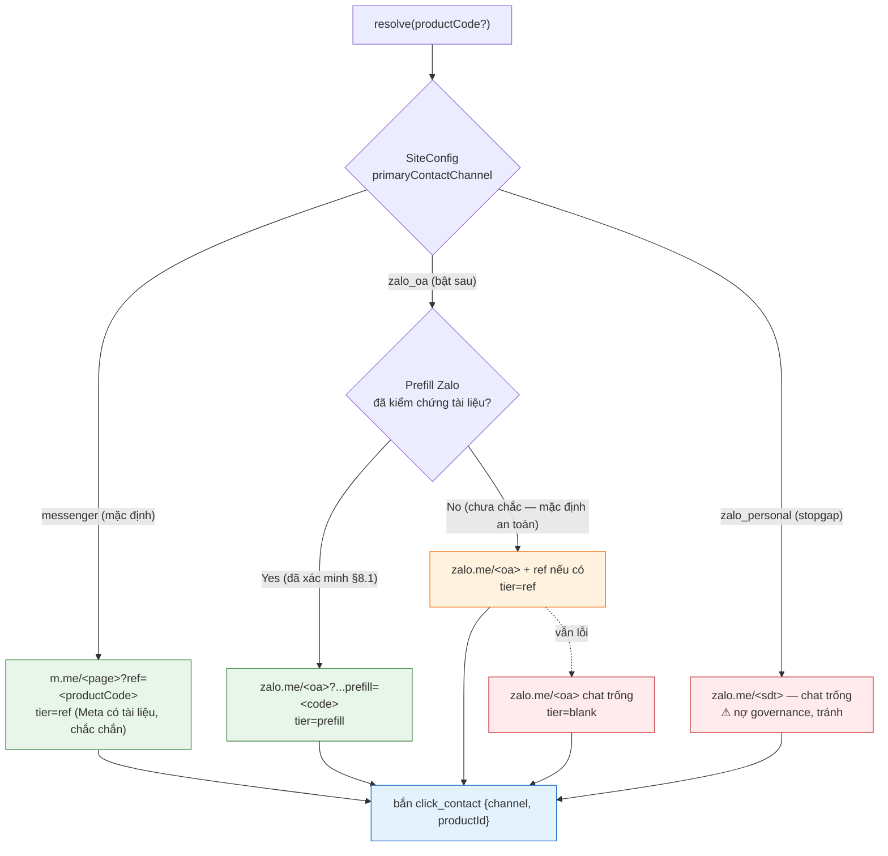

> **Giảm cấp 3 tầng (ADR-002, US-B1 AC3):** `prefill → ref → blank`. **Messenger** đạt thẳng `tier=ref` vì `m.me?ref=` mang mã SP **chắc chắn** (Meta documented) → đây là lý do chọn Messenger-first cho P2. **Zalo prefill** còn là ẩn số (PRD §8.1 BLOCKING) nên resolver mặc định hạ về `ref`/`blank` an toàn cho tới khi tài liệu Zalo Developer được xác minh. Resolver luôn trả một URL hợp lệ — **không bao giờ dead-end**.

```ts
// components/funnel/ContactChannelResolver.ts — thuần hàm, test được, giấu kênh sau 1 interface
export function resolveContact(productCode: string | undefined, cfg: SiteConfig): ResolvedContact {
  switch (cfg.primaryContactChannel) {
    case "messenger":
      return { channel: "messenger", tier: "ref",
               url: `https://m.me/${cfg.messengerPage}${productCode ? `?ref=${encodeURIComponent(productCode)}` : ""}`,
               label: "Nhắn Messenger về sản phẩm này" };
    case "zalo_oa":
      return buildZaloOa(productCode, cfg);   // prefill→ref→blank theo cờ cfg.zaloPrefillVerified
    case "zalo_personal":
      return { channel: "zalo_personal", tier: "blank",
               url: `https://zalo.me/${cfg.zaloPersonalPhone}`, label: "Nhắn Zalo" };
  }
}
```

**AC → thiết kế:** US-B1 AC1 (một chạm mở kênh với ngữ cảnh SP) → `tier=ref` mang `productCode`; US-B1 AC3 (prefill Zalo chưa kiểm chứng) → nhánh `zalo_oa` giảm cấp + cờ `zaloPrefillVerified`; US-B2 AC1 (widget thường trực) → §6.

---

## 5. UC-08 — `ContactCTA`: build deep-link + `click_contact` (D6)

```mermaid
sequenceDiagram
    autonumber
    participant U as Khách (mobile/desktop)
    participant CTA as ContactCTA (client)
    participant R as resolveContact()
    participant Cfg as SiteConfig (prefetch ISR, props)
    participant AN as analytics dispatcher
    participant Ext as Messenger / Zalo

    Note over Cfg: cfg truyền từ server component (RSC) xuống props — không fetch runtime
    U->>CTA: chạm "Nhắn Messenger về SP này"
    CTA->>R: resolve(productCode)
    R->>Cfg: đọc primaryContactChannel + page/oa
    R-->>CTA: ResolvedContact { channel, url, tier }
    CTA->>AN: click_contact { channel, productId } (sau consent analytics)
    CTA->>Ext: window.open(url) — m.me?ref=code (app mobile / web desktop)
    Ext-->>U: Mở hội thoại, NV thấy ngữ cảnh SP (ref)
    Note over CTA,Ext: P2 — KHÔNG tạo lead ở đây; webhook auto-lead là P3/P4 (cần Meta app review)
```

**Chi tiết:**
- `SiteConfig` được **server component prefetch** (ISR, như catalog) và truyền xuống `ContactCTA` qua props → không có fetch runtime, không chặn INP, cache CDN được (nhánh UC-08 không PII).
- `click_contact` chỉ bắn **sau consent analytics** (ConsentGate analytics, HLD Flow 3) — không PII, chỉ `{channel, productId}`.
- Desktop vs mobile: `m.me` tự điều hướng app/web; không cần nhánh code riêng.

**AC → thiết kế:** US-B1 AC1 → `resolve()` + `window.open`; US-B1 AC2 (`click_zalo` + productID) → **`click_contact{channel,productId}`** (đã tổng quát hoá, ADR-002); US-B1 AC3 → §4 giảm cấp.

---

## 6. UC-09 — `ContactFloatingWidget`: widget chat nổi + CSP (D7)

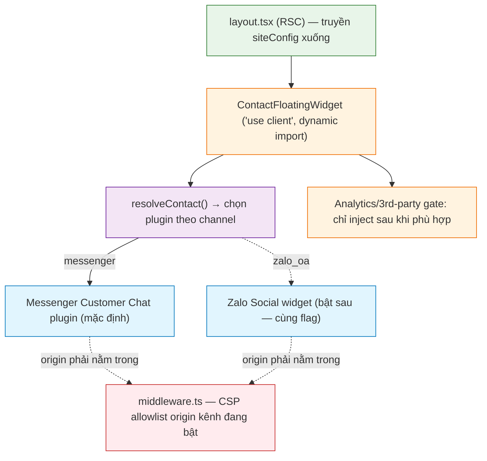

**Quyết định kiến trúc:**
- **Dynamic import** (code-split) để script plugin bên thứ ba **không chặn LCP** của trang (NFR-1; như chatbot widget ở §3 customer-facing).
- Plugin kênh đổi **qua cùng flag** `primaryContactChannel` — một nguồn sự thật với UC-08.
- **CSP allowlist bắt buộc** (M-3): origin của plugin đang bật (`connect.facebook.net`, `*.messenger.com` cho Messenger; origin Zalo khi bật) phải nằm trong CSP; đổi kênh ⇒ cập nhật allowlist (checklist §12 customer-facing). Đây là điểm **cần đồng bộ CSP ↔ flag**: xem Rủi ro §12.
- Messenger Customer Chat plugin cần **Page ID**; lưu ở `SiteConfig` (publishable, không phải secret).

**AC → thiết kế:** US-B2 AC1 (widget chat nổi thường trực mọi trang) → `ContactFloatingWidget` mount trong `layout.tsx`.

---

## 7. UC-10 — `LeadForm` + `POST /api/lead` (Epic C, US-C1 + US-H2)

### 7.1 Cây component (D8)

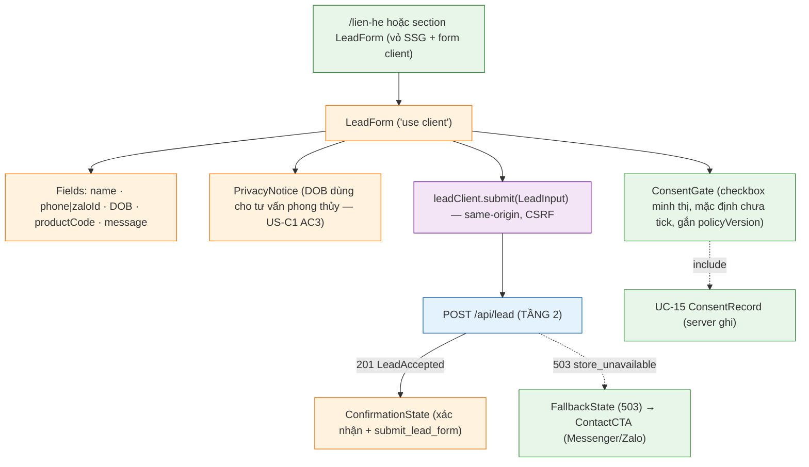

### 7.2 Sequence submit — consent+lead nguyên tử, 503 fallback (D9)

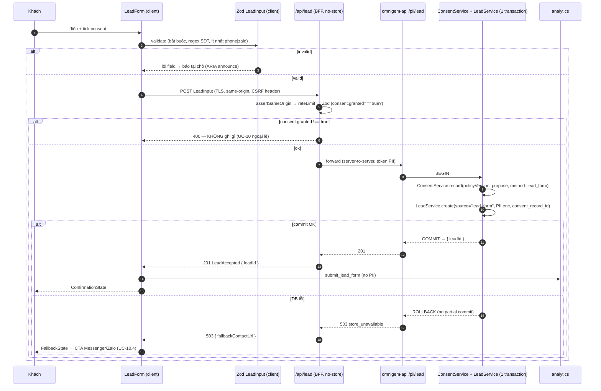

> **Bất biến chốt (HLD Flow 1):** ConsentRecord + Lead ghi trong **cùng 1 transaction** → không bao giờ partial. `consent.granted!==true` ⇒ từ chối **trước khi** chạm DB (Zod `literal(true)`). DB lỗi ⇒ `503 + fallbackContactUrl` (resolver cấp), **không** commit một nửa → UC-10.4 "không ngõ cụt".

### 7.3 State machine của form (D10)

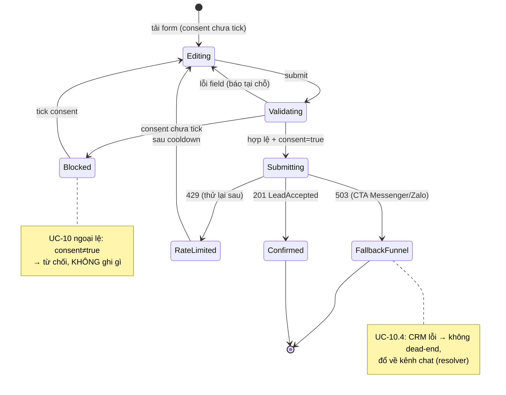

**Hợp đồng lỗi (bám api-spec, §8.3 customer-facing):** `400` field/consent; `403` origin/CSRF; `429` rate-limit; `503 store_unavailable {fallbackContactUrl}`. Mọi trạng thái lỗi có **lối ra phễu** (D13).

**AC → thiết kế:** US-C1 AC1 (validate trường/định dạng trước khi nhận) → Zod client+server; US-C1 AC2 (ghi CRM built-in + xác nhận) → D9 bước commit + `ConfirmationState`; US-C1 AC3 (privacy notice cho DOB) → `PrivacyNotice`; US-C1 AC4 (fixture chỉ synthetic) → §13 test; US-H2 → §8.

---

## 8. UC-15 — Consent (Art.11) & ConsentGate (D11, D12)

### 8.1 Hai loại consent (D11)

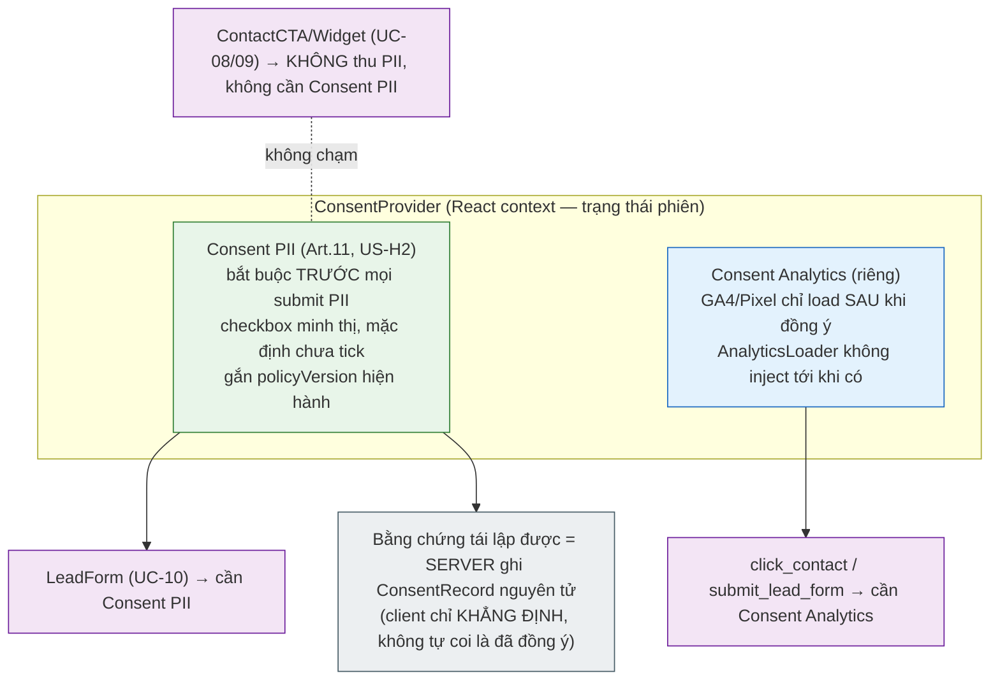

> **Ranh giới quan trọng:** UC-08/09 (mở kênh chat) **không thu PII trên web** nên **không cần Consent PII** — đây là lý do Epic B rẻ và cache được. Chỉ UC-10 (và chatbot UC-11/13) mới «include» UC-15. **Consent Analytics** là cổng riêng, độc lập, gate cho cả `click_contact` lẫn `submit_lead_form`.

### 8.2 Ghi nguyên tử ConsentRecord + Lead (D12)

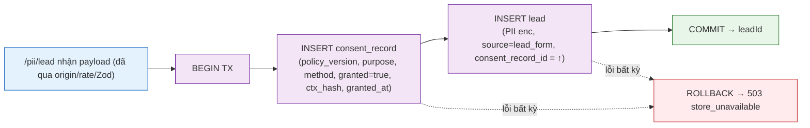

> **Tái lập được (US-H2 AC1/AC2):** ConsentRecord ghim **đúng version Privacy Policy đã hiển thị** (`policyVersion` khách gửi phải khớp version hiện hành server — nếu lệch do publish giữa chừng, server dùng version thực nó hiển thị và có thể từ chối/nhắc tải lại). Bản ghi này export được làm bằng chứng Art.11 (UC-20.5, Boundary 2). `request_ctx_hash` thay cho lưu IP thô (tối thiểu hoá dữ liệu).

**AC → thiết kế:** US-H2 AC1 (bản ghi tái lập: điều gì + version + timestamp + method) → cột `CONSENT_RECORD`; AC2 (truy xuất làm bằng chứng) → export ở UC-20.5 (contract Boundary 2); AC3 (Art.11 áp cho MỌI PII gồm DOB) → `LeadInput.consent` bắt buộc khi có `dobISO`.

---

## 9. "Không ngõ cụt" — cây quyết định phễu Epic B/C (D13)

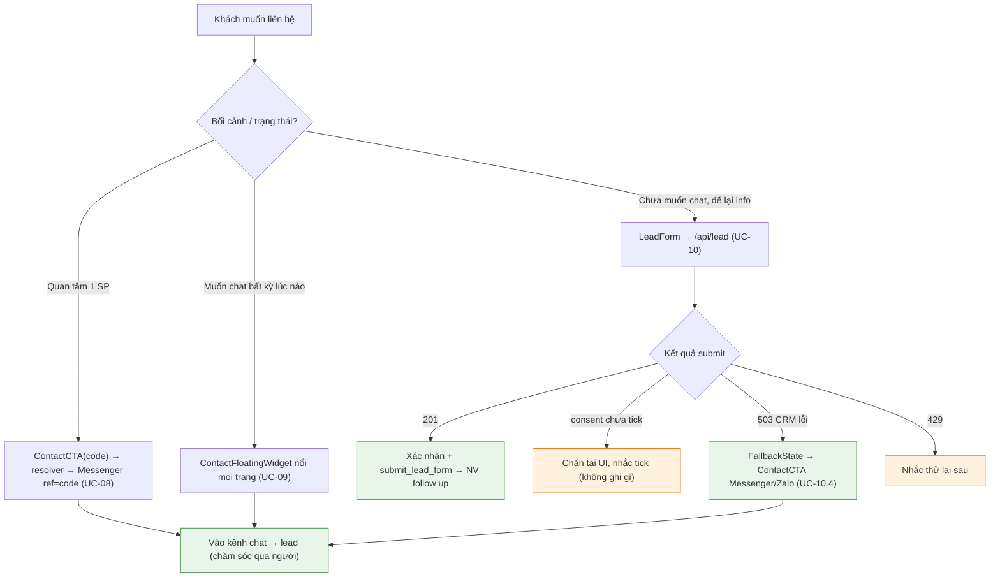

Mọi nhánh — kể cả lỗi CRM (503) và rate-limit — đều có **lối ra phễu**, nhất quán triết lý "không ngõ cụt" của Epic A (D17) và §14 customer-facing.

---

## 10. Analytics phễu (Epic G, UC-21; D14)

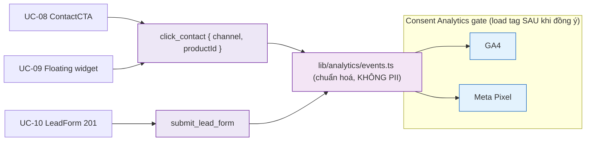

| Event | Nguồn | Khi | Payload (no PII) |
|---|---|---|---|
| `click_contact` | UC-08, UC-09 | Chạm CTA/widget chat | `{ channel: "messenger"\|"zalo_oa", productId? }` |
| `submit_lead_form` | UC-10 | Nhận `201 LeadAccepted` | `{}` (chỉ tên event) |

> **ADR-002:** `click_zalo` (PRD US-B1 AC2, US-G1) **tổng quát hoá → `click_contact{channel}`** để đo đúng kênh đang chạy (Messenger/Zalo) và phục vụ A-B test kênh (P4). **Không PII** (không name/phone/dob) — chỉ `productId` + `channel`. Tag chỉ load **sau consent analytics** (HLD Flow 3).

**AC → thiết kế:** US-B1 AC2 → `click_contact{channel,productId}`; US-G1 (`submit_lead_form` là event riêng có tên) → §10.

---

## 11. Cấu trúc thư mục lát cắt Epic B/C (D15)

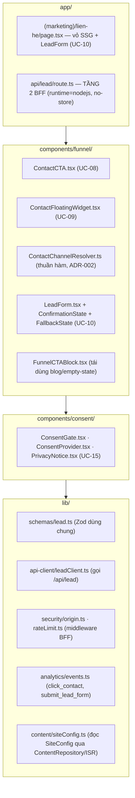

> Bám cấu trúc §5 customer-facing (`components/funnel/`, `components/consent/`, `lib/schemas`, `lib/security`). `ContactChannelResolver` là **thuần hàm** (dễ unit test mọi nhánh kênh/tier). `SiteConfig` đọc qua cùng `ContentRepository` của Epic A (prefetch ISR, truyền props).

---

## 12. Hợp đồng props & route (tóm tắt)

```ts
// components/funnel/ContactCTA.tsx ("use client")
interface ContactCTAProps {
  productCode?: string;            // UC-08: ref mang mã SP (Messenger tier=ref)
  siteConfig: SiteConfig;          // prefetch từ RSC (channel, page/oa) — không fetch runtime
  variant?: "bar" | "inline";      // CtaBar above-the-fold (US-A3 AC2) tái dùng
}

// components/funnel/ContactFloatingWidget.tsx ("use client", dynamic import)
interface ContactFloatingWidgetProps {
  siteConfig: SiteConfig;          // UC-09: chọn plugin Messenger/Zalo theo flag
}

// components/funnel/LeadForm.tsx ("use client")
interface LeadFormProps {
  defaultProductCode?: string;     // prefill khi mở từ Product Detail
  policyVersion: string;           // version hiện hành ghim vào consent (US-H2)
}

// app/api/lead/route.ts
// POST LeadInput → 201 LeadAccepted{leadId} | 400 | 403 | 429 | 503 StoreUnavailable{fallbackContactUrl}
// runtime = "nodejs"; headers: Cache-Control: no-store
```

---

## 13. Chiến lược test (lát cắt Epic B/C)

| Lớp | Phạm vi |
|---|---|
| **Unit** | `resolveContact()` — phủ mọi nhánh channel × tier (messenger/zalo_oa prefill/ref/blank/zalo_personal); Zod `LeadInput` (consent `literal(true)` reject; `.refine` phone\|zalo); `events.ts` không chứa PII. |
| **Integration** | `POST /api/lead`: (a) ghi **consent+lead nguyên tử**, (b) **reject khi consent≠true không ghi gì**, (c) **503 → rollback + fallbackContactUrl** (no partial commit), (d) origin/CSRF 403, (e) rate-limit 429. |
| **E2E (Playwright)** | Product → ContactCTA mở Messenger (assert URL `m.me?ref=code`); LeadForm submit 201 → confirmation; **consent gate chặn khi chưa tick**; 503 → fallback CTA hiển thị. |
| **PII convention** | **Chỉ dữ liệu synthetic** trong fixture/doc (US-C1 AC4) — không SĐT/DOB thật. |

---

## 14. Ma trận truy vết AC → thiết kế/sơ đồ

| US / AC | Thiết kế | Sơ đồ |
|---|---|---|
| US-B1 AC1 deep-link mang ngữ cảnh SP | `ContactCTA` + `resolveContact` tier=ref | D5, D6 |
| US-B1 AC2 event + productID | `click_contact{channel,productId}` (tổng quát `click_zalo`) | D6, D14 |
| US-B1 AC3 prefill Zalo chưa kiểm chứng | nhánh `zalo_oa` giảm cấp prefill→ref→blank | D5 |
| US-B2 AC1 widget chat nổi mọi trang | `ContactFloatingWidget` trong `layout.tsx` | D7 |
| US-C1 AC1 validate trường/định dạng | Zod `LeadInput` client+server (regex SĐT, phone\|zalo) | D4, D9, D10 |
| US-C1 AC2 ghi CRM + xác nhận | TX commit + `ConfirmationState` | D9, D12 |
| US-C1 AC3 privacy notice cho DOB | `PrivacyNotice` + `ConsentGate` | D8, D11 |
| US-C1 AC4 fixture synthetic | quy ước test | §13 |
| US-H2 AC1 bản ghi consent tái lập | `CONSENT_RECORD` (policy_version, method, timestamp) | D3, D12 |
| US-H2 AC2 truy xuất bằng chứng | export ở UC-20.5 (contract Boundary 2) | D12 |
| US-H2 AC3 Art.11 áp cho mọi PII (gồm DOB) | consent bắt buộc trong `LeadInput` | D4, D11 |
| US-G1 submit_lead_form là event riêng | `events.ts` | D14 |
| UC-10.4 CRM lỗi → fallback | 503 + `fallbackContactUrl` (resolver) | D9, D10, D13 |

---

## 15. Điểm cần chốt trước khi code Epic B/C

| # | Điểm | Trạng thái |
|---|---|---|
| 1 | **Cú pháp prefill deep-link Zalo** | **BLOCKING nhánh `zalo_oa`** (PRD §8.1, US-B1 AC3). P2 chạy **Messenger-first** nên **không chặn P2**; resolver giữ cờ `zaloPrefillVerified=false` + giảm cấp cho tới khi xác minh tài liệu Zalo Developer. |
| 2 | **Kênh handoff** | **CHỐT (ADR-002):** Messenger-first (`m.me?ref=code`) qua `ContactChannelResolver` + flag `SiteConfig.primaryContactChannel`; Zalo OA bật sau khi có doanh thu bằng đổi flag. |
| 3 | **Webhook auto-tạo lead từ Messenger/Zalo** | **Hoãn P3/P4** (cần Meta app review `pages_messaging`). P2: lead chỉ qua LeadForm (UC-10) + chatbot handoff (UC-13). |
| 4 | **ConsentRecord + Lead nguyên tử** | **CHỐT (HLD Flow 1):** cùng 1 transaction, `consent_record_id` NOT NULL, no partial commit; thực thi trong `omnigem-api` (ADR-001). |
| 5 | **CSP ↔ flag kênh** | Mở: khi đổi `primaryContactChannel`, phải cập nhật CSP allowlist origin plugin (Messenger ↔ Zalo). Đề xuất: sinh CSP từ `SiteConfig` ở `middleware.ts` để tránh lệch thủ công — chốt ở LLD. |
| 6 | **Nội dung privacy notice cho DOB** | Chờ compliance xác nhận câu chữ (PRD §8.2) — ảnh hưởng `PrivacyNotice`, không ảnh hưởng cấu trúc. |
| 7 | **Base URL + schema PII endpoint `omnigem-api`** | Topology CHỐT (ADR-001); schema `/pii/lead` cụ thể chốt ở Design; `leadClient`/BFF giữ hợp đồng ổn định + mock để không chặn P2. |

**Mô hình vận hành đã xác nhận (ADR-002):** thu lead (LeadForm P2 / chatbot P3 / webhook P3-P4) → chăm sóc + chốt qua người (Messenger) → ship / kéo về cửa hàng → *(tương lai)* bán online. NG1 (không checkout) giữ nguyên.
