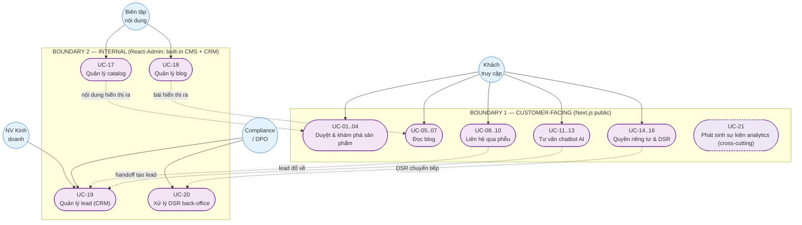
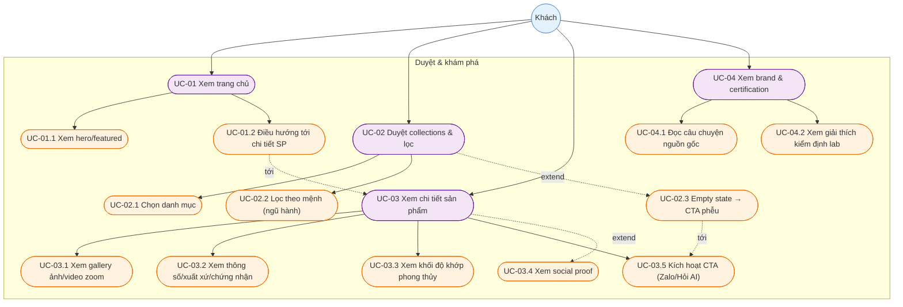
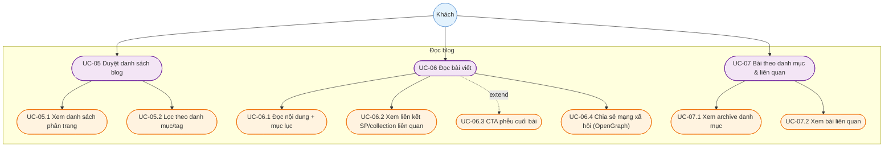
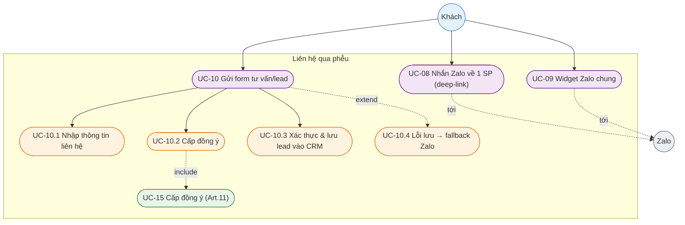
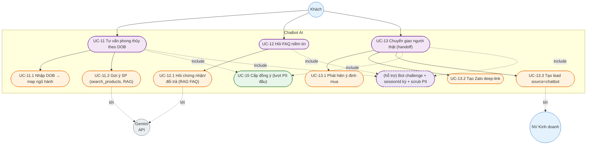
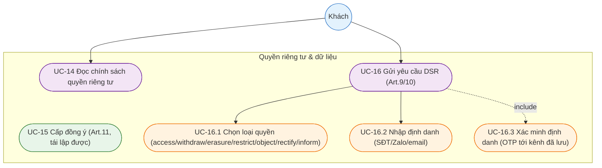
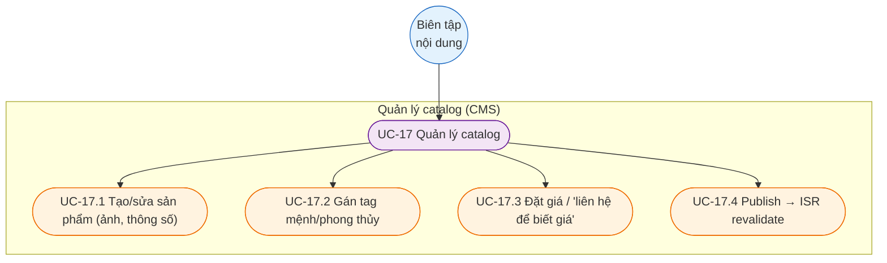
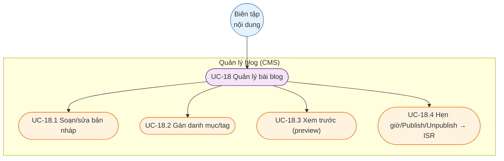
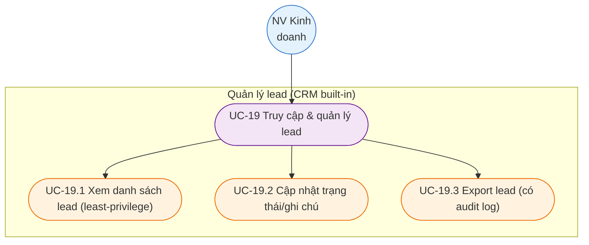
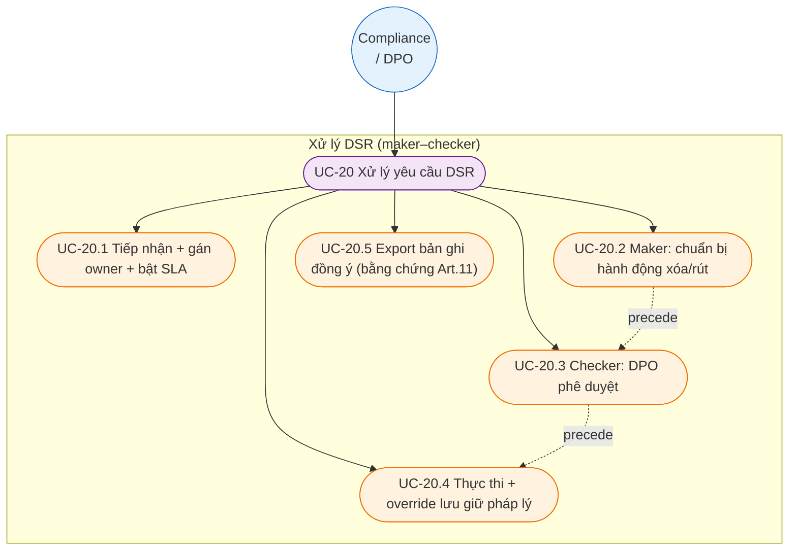

# OmniGem Gallery — Tài liệu Use Case (Phân rã chức năng hệ thống)

Trạng thái: **ĐÃ CHỐT (APPROVED)** — chốt ngày 2026-10-15. Nguồn: `omni-web/prd/PRD.md` (các Epic A, B, C, D, E, F, G, H, I).
Mục đích: cho cái nhìn tổng quan *ai (actor) làm gì (use case) với hệ thống*, phân rã theo **2 boundary** (ranh giới hệ thống) và chi tiết hóa từng use case lớn thành use case con.

> Ghi chú đồng bộ: bám theo PRD đã cập nhật — chatbot dùng **Gemini API**, nội dung quản lý qua **built-in CMS (React-Admin)**, lead lưu ở **CRM built-in**.

---

## 1. Phạm vi & triết lý

OmniGem Gallery = showroom số + cỗ máy niềm tin + phễu dẫn về Zalo/Chatbot (không phải sàn TMĐT). Phần lớn use case của khách đều **kết thúc bằng một lối vào phễu** (Zalo/chatbot/form). Mọi use case thu thập dữ liệu cá nhân đều **include** bước cấp đồng ý (consent).

## 2. Hai Boundary (ranh giới hệ thống)

| Boundary | Hệ thống kỹ thuật | Actor tương tác | Đặc tính |
|---|---|---|---|
| **Boundary 1 — Customer-facing** | Website công khai (Next.js, SSG/ISR) + widget | Khách truy cập | Công khai, không đăng nhập, SEO-first, không chứa PII ở trang tĩnh |
| **Boundary 2 — Internal** | Trang quản trị (React-Admin): built-in CMS + CRM | Biên tập viên, NV kinh doanh, Compliance/DPO | Có xác thực, phân quyền (SoD), chạm PII, audit log |

## 3. Danh sách Actor

### Actor chính (Primary)
| Actor | Boundary | Mô tả | Persona (PRD §3) |
|---|---|---|---|
| **Khách truy cập** (Visitor) | 1 | Duyệt web, đọc blog, hỏi chatbot, để lại lead | Khách phong thủy · Khách mua quà · Nhà sưu tầm |
| **Biên tập viên nội dung** (Content Editor) | 2 | Quản lý catalog & blog qua CMS | — |
| **Nhân viên kinh doanh** (Sales Staff) | 2 | Tiếp nhận & chốt lead trên Zalo, truy cập CRM | — |
| **Compliance / DPO** | 2 | Xử lý DSR, export bản ghi đồng ý | — |

### Actor phụ / hệ thống ngoài (Secondary / External)
Gemini API (Google) · Zalo (OA + widget) · GA4 / Meta Pixel · Cloudinary · (Built-in CMS/CRM là nội bộ, không phải hệ thống ngoài).

---

## 4. Sơ đồ Use Case TỔNG QUAN (2 boundary)

**Đọc sơ đồ:** actor nằm ngoài boundary. Mũi tên nét đứt giữa 2 boundary thể hiện dòng dữ liệu (lead từ customer-facing đổ về CRM internal; nội dung từ CMS internal hiển thị ra public). UC-21 vẽ nét đứt vì là chức năng cross-cutting (đính kèm nhiều use case khác).

---

## 5. Phân rã Use Case (catalog phân cấp) + sơ đồ chi tiết

Mỗi use case lớn dưới đây được phân rã thành use case con (UC-xx.y) kèm một sơ đồ chi tiết thể hiện quan hệ `«include»` (bắt buộc kèm theo) / `«extend»` (mở rộng có điều kiện).

### BOUNDARY 1 — CUSTOMER-FACING

#### UC-01..04 — Duyệt & khám phá sản phẩm (Epic A)

#### UC-05..07 — Đọc blog (Epic I)

#### UC-08..10 — Liên hệ qua phễu (Epic B, C)

#### UC-11..13 — Tư vấn chatbot AI (Epic D)

#### UC-14..16 — Quyền riêng tư & DSR (Epic H, phía khách)

### BOUNDARY 2 — INTERNAL (React-Admin: built-in CMS + CRM)

#### UC-17 — Quản lý catalog (Epic F)

#### UC-18 — Quản lý blog (Epic I)

#### UC-19 — Quản lý lead / CRM (Epic C/D phía nội bộ)

#### UC-20 — Xử lý DSR back-office (Epic H phía nội bộ)

### Cross-cutting — UC-21 Đo lường analytics (Epic G)

UC-21 không thuộc riêng một actor; nó được `«include»` bởi các use case tương tác then chốt ở Boundary 1 (sau khi có đồng ý analytics), phát sinh các sự kiện **không chứa PII**:

| Sự kiện | Phát sinh từ |
|---|---|
| `view_product` | UC-03 |
| `click_zalo` | UC-08, UC-09 |
| `submit_lead_form` | UC-10 |
| `chatbot_handoff` | UC-13 |

---

## 6. Bảng tổng hợp quan hệ include / extend

| Quan hệ | Chi tiết |
|---|---|
| `«include»` | UC-10.2, UC-11, UC-13 **→ UC-15** (cấp đồng ý; không consent thì không xử lý PII) |
| `«include»` | UC-13 **→ lõi lưu lead của UC-10** (lead chatbot & form vào cùng CRM — nguồn sự thật duy nhất) |
| `«include»` | UC-11/12/13 **→ bảo vệ phiên chatbot** (bot challenge + sessionId ký + scrub PII trước khi gọi Gemini) |
| `«include»` | UC-16 **→ UC-16.3** xác minh định danh (OTP) trước khi UC-20 thực thi |
| `«include»` | UC-01..03, UC-08..10, UC-13 **→ UC-21** phát sinh sự kiện analytics |
| `«extend»` | UC-02 **→ UC-02.3** empty state → CTA phễu (chỉ khi không có kết quả) |
| `«extend»` | UC-03 **→ UC-03.4** social proof (chỉ khi có media chứng thực) |
| `«extend»` | UC-06 **→ UC-06.3** CTA phễu cuối bài |
| `«extend»` | UC-10 **→ UC-10.4** fallback Zalo (chỉ khi CRM lỗi) |

---

## 7. Hai đặc tả Use Case mẫu (template để mở rộng)

> Các UC khác hiện ở mức danh mục + phân rã sơ đồ. Có thể mở rộng thành đặc tả đầy đủ theo template dưới.

### UC-10 — Gửi form tư vấn/lead

| Trường | Nội dung |
|---|---|
| **Boundary** | 1 — Customer-facing |
| **Actor chính** | Khách truy cập |
| **Mục tiêu** | Để lại thông tin liên hệ + nhu cầu để nhân viên follow up |
| **Tiền điều kiện** | Trang Liên hệ đã tải; chính sách quyền riêng tư (có version) hiển thị |
| **Hậu điều kiện (thành công)** | 1 Lead + 1 ConsentRecord ghi nguyên tử vào CRM; bắn `submit_lead_form` (không PII) |

**Luồng chính:** (UC-10.1) nhập tên/SĐT-Zalo/DOB/nhu cầu → tick đồng ý gắn version chính sách → submit → kiểm origin/CSRF → rate-limit → xác thực schema → **«include» UC-15** ghi ConsentRecord trong cùng transaction → (UC-10.3) ghi Lead (`source="lead_form"`, PII mã hóa) → trả 201 → bắn analytics.
**Ngoại lệ:** thiếu/sai trường → báo lỗi tại chỗ; `consent≠true` → từ chối, không ghi gì; (UC-10.4) CRM lỗi → 503 + CTA fallback Zalo, không commit một phần.
**Quy tắc:** Art.11 đồng ý bắt buộc cho mọi PII (gồm DOB); không PII trong analytics; không commit một phần.

### UC-13 — Chuyển giao người thật (chatbot handoff)

| Trường | Nội dung |
|---|---|
| **Boundary** | 1 — Customer-facing (lead đổ sang Boundary 2) |
| **Actor chính** | Khách truy cập → Nhân viên kinh doanh (tiếp nhận trên Zalo) |
| **Mục tiêu** | Kết nối khách có ý định mua tới người thật để chốt giao dịch giá trị cao |
| **Tiền điều kiện** | Phiên chatbot hợp lệ (bot challenge, sessionId ký HMAC); đã cấp đồng ý nếu lượt mang PII |
| **Hậu điều kiện (thành công)** | Zalo deep-link tạo ra; 1 lead `source="chatbot"` lưu CRM, liên kết ConsentRecord phiên |

**Luồng chính:** (UC-13.1) chatbot phát hiện ý định mua → gọi tool `handoff_to_zalo()` → (UC-13.2) build Zalo deep-link → **«include» lõi UC-10** (UC-13.3) tạo Lead (`source="chatbot"`, gắn ConsentRecord, rate-limit/dedupe theo phiên) → bắn `chatbot_handoff` → hiển thị link cho khách.
**Ngoại lệ:** bot không tự tin (giá/đơn custom) → đề nghị handoff thay vì đoán; Gemini API lỗi/timeout hoặc chạm trần chi tiêu → fallback tin nhắn + CTA Zalo.
**Quy tắc:** handoff bắt buộc trước mọi cam kết mua; lead chatbot & form vào cùng CRM; chống spam lead do injection.
